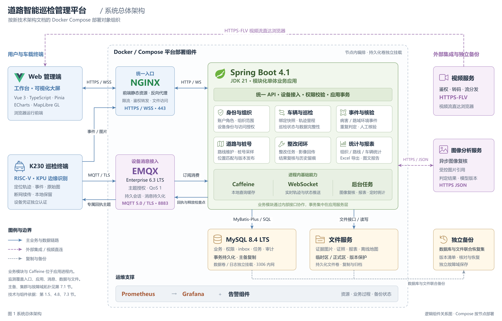
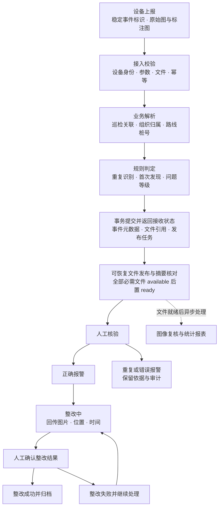
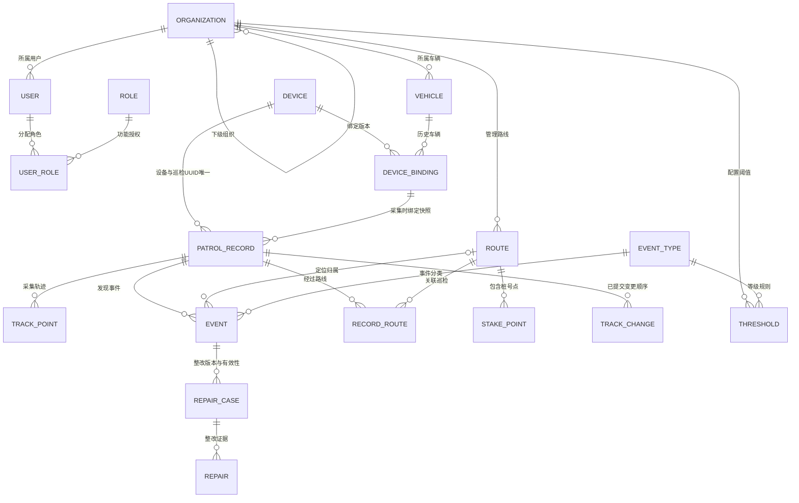
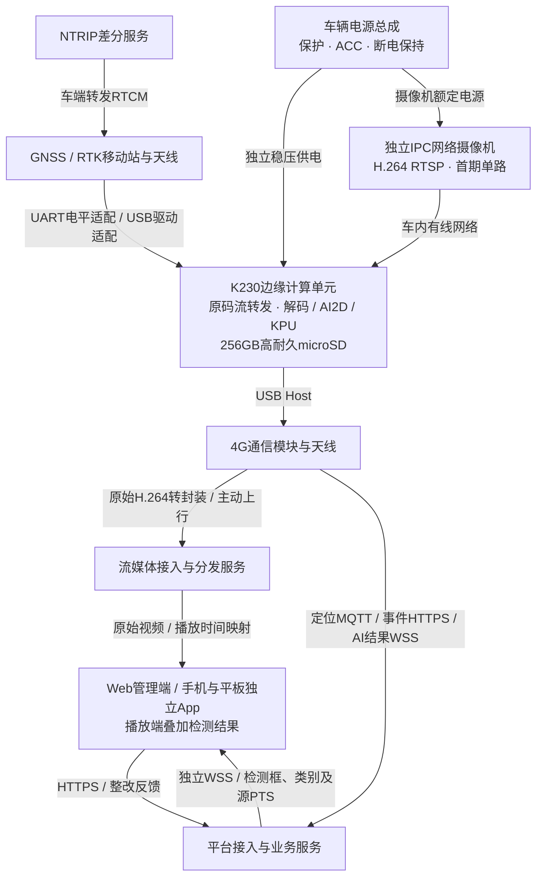
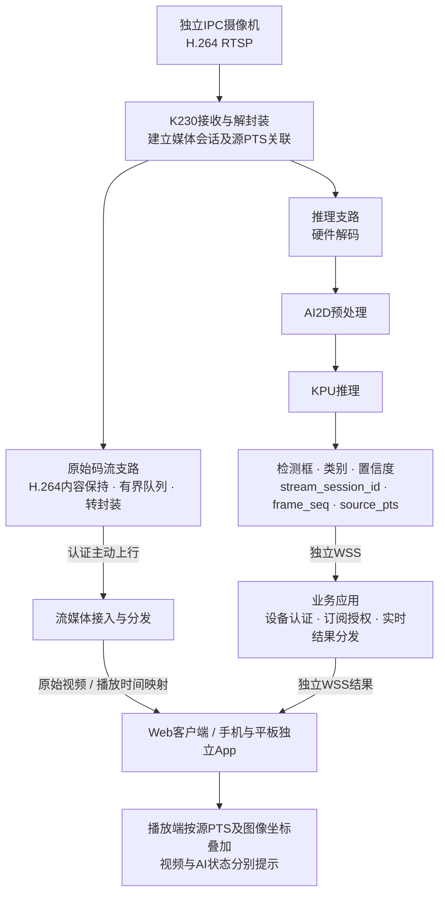
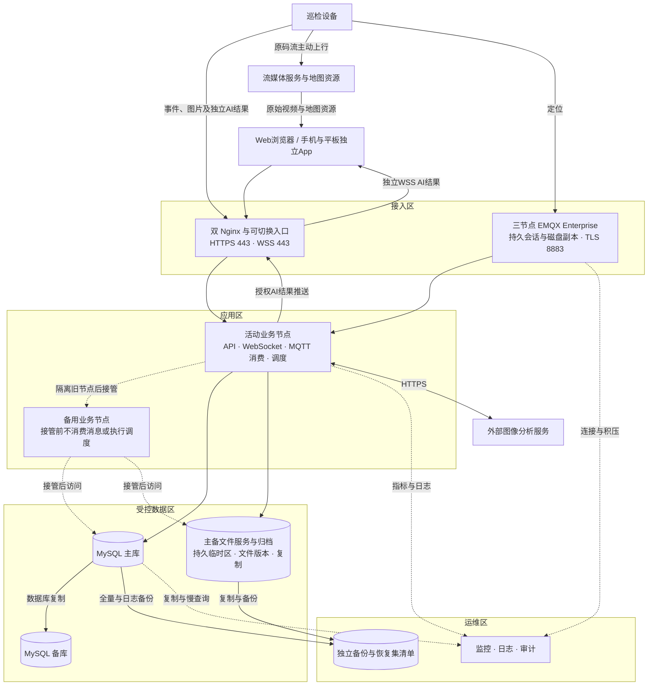

# 道路智能巡检管理平台系统架构设计文档

版本 V1.7　｜　修订日期 2026年11月9日　｜　文档类型 架构设计

本文档规定道路智能巡检管理平台重构的业务边界、逻辑与物理架构、软硬件技术基线、数据与接口规范、部署运维及安全保障要求，作为详细设计、设备选型、系统集成和验收的设计依据。文档状态为设计修订稿，实行开发设计基线与生产验收基线两阶段管理：业务协议、状态及事务约束经评审批准后纳入开发基线；目标拓扑、性能和恢复能力经验证后纳入生产验收基线。本文所列配置与指标均须按相应阶段完成评审和验证。

## 目录

- [一、引言](#一引言)
  - [1.1 项目背景](#11-项目背景)
  - [1.2 建设目的](#12-建设目的)
  - [1.3 建设范围](#13-建设范围)
  - [1.4 文档作用与读者](#14-文档作用与读者)
  - [1.5 技术基线与设计约定](#15-技术基线与设计约定)
- [二、系统概述](#二系统概述)
  - [2.1 系统定位](#21-系统定位)
  - [2.2 核心功能](#22-核心功能)
  - [2.3 主要用户](#23-主要用户)
  - [2.4 高层业务流程](#24-高层业务流程)
  - [2.5 业务状态与统计口径](#25-业务状态与统计口径)
  - [2.6 事件确认与整改的联合约束](#26-事件确认与整改的联合约束)
- [三、系统架构](#三系统架构)
  - [3.1 总体架构](#31-总体架构)
  - [3.2 前端架构](#32-前端架构)
    - [3.2.1 Web管理端与大屏](#321-web管理端与大屏)
    - [3.2.2 手机与平板独立App](#322-手机与平板独立app)
  - [3.3 后端分层与组件职责](#33-后端分层与组件职责)
  - [3.4 关键交互设计](#34-关键交互设计)
    - [3.4.1 定位数据处理](#341-定位数据处理)
    - [3.4.2 事件接入与规则处理](#342-事件接入与规则处理)
    - [3.4.3 巡检结束与补偿](#343-巡检结束与补偿)
    - [3.4.4 图像复核与外部服务](#344-图像复核与外部服务)
  - [3.5 数据架构](#35-数据架构)
  - [3.6 一致性与异常处理](#36-一致性与异常处理)
  - [3.7 车载终端与平台物理架构](#37-车载终端与平台物理架构)
    - [3.7.1 原始视频转发与AI结果独立传输](#371-原始视频转发与ai结果独立传输)
- [四、技术选型](#四技术选型)
  - [4.1 前端技术](#41-前端技术)
  - [4.2 后端技术](#42-后端技术)
  - [4.3 数据库选型](#43-数据库选型)
  - [4.4 缓存选型](#44-缓存选型)
  - [4.5 消息与实时通信](#45-消息与实时通信)
  - [4.6 地图与桩号技术](#46-地图与桩号技术)
  - [4.7 文件与报表技术](#47-文件与报表技术)
  - [4.8 部署与可观测性技术](#48-部署与可观测性技术)
  - [4.9 硬件选型原则与技术约束](#49-硬件选型原则与技术约束)
- [五、接口与协议](#五接口与协议)
  - [5.1 接口总体约定](#51-接口总体约定)
  - [5.2 管理接口](#52-管理接口)
  - [5.3 设备事件上报协议](#53-设备事件上报协议)
  - [5.4 巡检结束及整改协议](#54-巡检结束及整改协议)
  - [5.5 MQTT 定位协议](#55-mqtt-定位协议)
  - [5.6 WebSocket 协议](#56-websocket-协议)
  - [5.7 文件与外部服务协议](#57-文件与外部服务协议)
  - [5.8 硬件接入与边缘处理规范](#58-硬件接入与边缘处理规范)
  - [5.9 原始视频与AI结果分离传输协议](#59-原始视频与ai结果分离传输协议)
    - [5.9.1 媒体上行与播放](#591-媒体上行与播放)
    - [5.9.2 AI结果通道与字段](#592-ai结果通道与字段)
    - [5.9.3 时间对齐与独立降级](#593-时间对齐与独立降级)
- [六、非功能性需求](#六非功能性需求)
  - [6.1 容量规划基线](#61-容量规划基线)
  - [6.2 性能指标](#62-性能指标)
  - [6.3 可用性与可靠性](#63-可用性与可靠性)
  - [6.4 可扩展性](#64-可扩展性)
  - [6.5 可维护性与可测试性](#65-可维护性与可测试性)
  - [6.6 易用性与兼容性](#66-易用性与兼容性)
  - [6.7 单车硬件容量与环境适应性](#67-单车硬件容量与环境适应性)
- [七、部署与运维](#七部署与运维)
  - [7.1 部署拓扑](#71-部署拓扑)
  - [7.2 软硬件环境](#72-软硬件环境)
  - [7.3 容器及端口设计](#73-容器及端口设计)
  - [7.4 配置管理](#74-配置管理)
  - [7.5 部署发布流程](#75-部署发布流程)
  - [7.6 监控与报警](#76-监控与报警)
  - [7.7 日志、备份与恢复](#77-日志备份与恢复)
  - [7.8 日常运行管理](#78-日常运行管理)
  - [7.9 硬件配置与采购预算](#79-硬件配置与采购预算)
    - [7.9.1 配置范围与计价依据](#791-配置范围与计价依据)
    - [7.9.2 车载设备配置](#792-车载设备配置)
    - [7.9.3 单车验证平台与操作终端](#793-单车验证平台与操作终端)
    - [7.9.4 投资估算汇总](#794-投资估算汇总)
    - [7.9.5 扩展配置与采购控制](#795-扩展配置与采购控制)
- [八、安全与合规性](#八安全与合规性)
  - [8.1 安全总体策略](#81-安全总体策略)
  - [8.2 身份认证与会话管理](#82-身份认证与会话管理)
  - [8.3 功能与数据权限](#83-功能与数据权限)
  - [8.4 传输与存储安全](#84-传输与存储安全)
  - [8.5 隐私保护与数据生命周期](#85-隐私保护与数据生命周期)
  - [8.6 审计日志](#86-审计日志)
  - [8.7 合规管理要求](#87-合规管理要求)
  - [8.8 安全与架构验收](#88-安全与架构验收)
  - [8.9 原型验证与分阶段基线管理](#89-原型验证与分阶段基线管理)

## 一、引言

### 1.1 项目背景

道路日常养护需要持续掌握路面病害、路域环境和巡检车辆运行情况。传统人工巡查在问题定位、影像留存、重复问题识别、整改跟踪和跨单位统计方面存在信息分散、时效不足和统计口径不一致的问题。车载智能识别设备能够采集道路图像、识别疑似问题并记录定位轨迹，管理平台负责将这些数据转化为可核查、可处置、可追溯的业务信息。

道路智能巡检管理平台面向道路管理单位、基层巡检单位和养护企业，覆盖“车辆巡检—事件发现—人工核验—整改反馈—统计分析”的业务链路。平台通过统一组织、路线和桩号数据，将车辆、轨迹、图像、事件及整改结果关联起来，为日常管理和养护决策提供数据支撑。

### 1.2 建设目的

平台建设目标包括：统一接入巡检设备上报的数据；形成按车辆和巡检批次组织的过程档案；将病害和路域环境问题准确关联至路线、桩号及责任单位；支持人工确认、重复识别、首次发现判断和问题等级划分；提供可视化大屏、管理工作台和报表；建立适用于生产运行的访问控制、审计、备份和故障恢复机制。

### 1.3 建设范围

系统范围包括Web管理端与可视化大屏、独立安装的手机/平板App、业务应用服务、设备数据接入、定位轨迹处理、道路及桩号管理、事件与整改管理、车辆管理、组织用户管理、病害阈值管理、统计分析、文件管理及系统运维。App承担移动巡检查看、实时视频与AI结果叠加、事件核查和整改反馈。

配套硬件设计范围包括车载图像采集、边缘识别计算、定位通信、车载供电与防护，以及平台计算、存储、网络、备份和操作终端。设备侧识别算法、摄像头驱动、专业视频处理和地图测绘生产由对应设备或专业服务承担，通过约定接口与平台集成；各交付方的责任及验收边界应在详细设计中明确。平台管理识别结果与人工核验结论，算法准确率依据专项测试评估；PCI等指标应记录来源、计算范围和口径，单事件指标不直接作为整条道路的评价结论。

硬件采购按1台巡检车、设备全部新购、中国境内采购编制初期配置及预算，见第7.9节。第6.1节的100车容量规划作为扩展设计负载保留；单车采购配置与扩展容量指标分别验证。生产部署仍应满足第7.1节的故障域及恢复要求。

### 1.4 文档作用与读者

项目负责人依据本文档确认建设边界与交付内容；架构及开发人员据此开展模块、数据库和接口详细设计；测试人员据此编制场景测试及验收用例；部署与运维人员据此建立运行环境、监控、备份及应急预案。需求和接口发生变化时，应同步更新对应章节并保留版本记录。

### 1.5 技术基线与设计约定

平台采用浏览器与服务端分离架构。前端使用Vue 3、TypeScript、Vite、Pinia、Vue Router、Ant Design Vue和ECharts；后端目标使用JDK 21、Spring Boot 4.1与适配Boot 4的MyBatis-Plus；结构化数据存储采用MySQL Community Server 8.4 LTS；查询缓存采用Caffeine；定位通信采用MQTT 5.0与EMQX Enterprise 6.3 LTS；实时推送采用WebSocket；入口采用Nginx，部署采用Docker与Compose。JDK 21与后端依赖要求见第4.2节，具体发行物、补丁、适配及授权信息纳入发布清单，实施范围以开发设计基线批准结果为准。

车端边缘控制与识别核心采用嘉楠Kendryte K230，按RISC-V64架构构建，模型使用KPU及配套nncase运行时；参考CanMV-K230或同芯片工业模组，具体板卡版本、内存和外设引出方式在样机验证后固化。本文“边缘MCU”指上述K230边缘控制与推理单元；相机、GNSS、4G通信及独立供电保护仍由相应硬件承担。车端与平台分开构建和发布。首期车端采用独立IPC网络摄像机，输出H.264 RTSP至K230；K230将原始编码数据转发至流媒体服务，同时解码、AI2D预处理及KPU推理，AI结果经独立数据通道传输，Web和独立App在播放端叠加。手机、平板使用独立安装App，采用独立构建与发布流程，复用平台业务及权限契约。

地图采用 MapLibre GL 与 PMTiles 离线底图，并保留高德在线地图适配能力。Excel 导出采用 Apache POI 的 SXSSF 流式写入，图文报告采用受控的 Word 模板生成组件。具体发行物、补丁版本和镜像摘要通过构建清单与锁文件统一管理，发布制品包含可追溯的版本号。

文档遵循以下约定：业务时间以 Asia/Shanghai 为统一展示时区；设备定位原始坐标以 WGS84 表达；地图展示按适配器转换至相应坐标系；距离以米、巡检汇总里程以千米、面积以平方米计量；设备侧字段沿用 snake_case，管理端字段采用 camelCase；事件上报标识与平台主键分别管理。

巡检业务键统一为 `(device_uid, patrol_uid)`，详情见第3.4.1节；`track_seq` 只表示设备采集顺序，`change_seq` 表示平台已提交变更顺序，两者不得替代。文中的“接收完成”“处理完成”“允许车端删除”分别对应不同的回执与检查点，不以 Broker 的 PUBACK 代替业务完成。

## 二、系统概述

### 2.1 系统定位

平台是道路巡检业务的数据汇聚、问题核查和管理分析系统。车端持续产生定位与识别结果，平台完成身份校验、业务归属、位置匹配、数据存储和展示，并通过整改接口实现问题处理闭环。平台以组织和道路资产作为管理基础，以巡检记录作为过程主线，以事件作为问题管理对象。

### 2.2 核心功能

**巡检监控。** Web大屏及手机/平板独立App展示巡检车辆、设备状态、实时与历史轨迹、里程、时间及原始视频，支持按组织、路线、车辆和时间筛选。视频和AI结果分别接收，由客户端按媒体时间戳叠加检测框、类别及置信度，并独立提示视频、推理和同步状态。

**病害与路域环境管理。** 分别管理路面病害和路域环境事件，提供类型、位置、桩号、车道、面积、PCI、等级、首次发现、确认属性及图像等信息，支持人工核验、筛选、详情查看和数据导出。

**整改管理。** 管理待整改问题、整改中问题和整改结果；支持整改图片回传、时间和位置关联，以及整改成功或失败的人工确认。

**道路与桩号管理。** 维护路线编码、起止桩号、管养单位、路线轨迹和桩号采样点，提供基于路线、距离与航向的桩号匹配，以及桩号采样、校核和发布能力。

**组织与基础资料管理。** 维护层级组织、用户、权限、车辆、设备、视频流地址和养护企业，并配置病害等级阈值与首次发现规则。

**统计分析与报表。** 提供组织和路线问题排名、巡检里程统计、病害分布、问题等级分析、整改统计和三级单位大屏，生成巡检记录、车辆清单和图文报告。

### 2.3 主要用户

平台管理员负责组织、账户、权限和系统参数；道路主管单位管理人员查看授权辖区与下级单位数据；基层巡检人员查看巡检过程、核验事件并补充问题信息；养护人员接收和反馈整改数据；运维人员维护系统运行、监控和备份。用户的业务角色与所属组织分别建模，通过功能权限和数据范围共同约束操作。

设备属于独立接入主体，使用设备凭证上报数据，不复用人员账户。外部图像分析、视频和地图服务属于集成服务主体，其可访问范围受服务权限控制。

### 2.4 高层业务流程

1. 管理员建立组织、养护企业、路线和桩号数据，登记车辆、设备及流地址，为用户分配角色和数据范围。
2. 车辆开始巡检，设备生成不可复用的 patrol_uid，并携带采集时有效的设备绑定版本上报数据。平台按 `(device_uid, patrol_uid)` 创建或定位巡检记录，固定车辆与组织历史归属，持久化接收记录后回执，再处理轨迹和实时推送。
3. 设备通过 HTTP 接口上报识别事件及原始图、标注图。平台进行校验、幂等判断、组织归属、桩号匹配、重复判断和等级判定，形成待核验事件。
4. 管理人员确认事件为正确报警、重复报警或错误报警。正确报警进入整改流程，重复与错误记录保留判定依据。
5. 养护人员使用手机/平板独立App获取整改任务，回传图片、拍摄位置及时间；App管理受控离线待上传任务，管理人员在授权客户端确认整改结果。
6. 设备提交结束清单，平台核对最终轨迹序号、事件清单与文件状态，汇总里程和路线。失联先标记为中断；补偿关闭和迟到数据按明确窗口处理，不以失联时间直接认定实际巡检结束。
7. 大屏和工作台按统一口径汇总巡检、事件与整改数据，用户按权限生成报表。

### 2.5 业务状态与统计口径

巡检过程状态为 running 进行中、interrupted 通信中断、closing 待结算和 closed 已关闭；另设数据完整性状态 pending 待核对、complete 完整、partial 存在缺项和 unknown 无最终清单。关闭不自动表示完整。冻结状态及迟到截止规则见第3.4.3节。

事件确认属性采用四种值：0 待确认、1 正确报警、2 重复报警、3 错误报警。首次发现和问题等级是独立属性，不代替确认属性。事件的有效整改状态包括 not_applicable 不适用、init 未整改、rectification 整改中、success 整改成功、fail 整改失败；有效整改状态由当前有效整改单计算。只有正确报警可有有效整改单，其他属性的有效整改状态必须为 not_applicable。

“采集事件数”统计已处理且必需文件可用的上报；“有效问题数”统计有效确认属性为正确报警的事件；“待核验数”包括原始待确认及重复关联失效后待重新核验的事件；“整改成功率”按统计范围内已进入整改流程的有效问题计算。重复关联的有效性按第2.6节派生，不只读取事件行中尚未更新的确认字段。接收未处理、文件待发布与隔离数据分别展示。每份统计均注明时间字段、组织范围、过滤条件、数据与重复关联修订版本和生成时间。

### 2.6 事件确认与整改的联合约束

事件行保存确认属性和版本号，整改单保存独立 case_id、流程状态、有效性、创建版本及事件引用。数据库保证每个事件至多一张当前有效整改单；应用事务同时校验确认属性与整改状态，接口不能分别更新成不合法组合。

| 触发动作 | 前置条件 | 同事务内的结果 |
| --- | --- | --- |
| 待确认改为正确报警 | 具备核验权限，事件版本一致，必需证据可用 | 确认属性置1，创建当前有效整改单，初始状态为 init |
| 开始整改 | 正确报警，整改单有效，状态为 init 或 fail | 转为 rectification，登记责任人与处理记录 |
| 确认整改结果 | 正确报警，整改单有效且为 rectification，证据可用 | 转为 success 或 fail，保存结论与依据 |
| 待确认、重复或错误报警直接整改 | 确认属性不为1 | 拒绝操作，不生成或恢复有效整改单 |
| 正确报警纠正为待确认、重复或错误 | 具备纠错权限，提供原因，事件与整改单版本均一致 | 旧整改单有效性置 voided，事件有效整改状态置 not_applicable；进行中的任务终止或标记取消 |
| 纠错后再次确认正确报警 | 具备核验权限，最新证据和版本校验通过 | 创建新 case_id，重新从 init 开始，不复用旧单的 success 结果 |
| 改判为重复报警 | 提供有权限访问、有效确认属性为正确报警的直接原始事件 | 在重复关系串行化事务内校验非自身、直接根事件与关联版本；保留旧关系及证据，不自动合并或转移 |

已完成整改单被纠错时，历史 success 或 fail 结论原样保留，并增加失效原因、操作者与时间；“取消业务有效性”不等于抹除已发生的整改。所有纠错与事件版本递增、审计和统计修订任务在同一事务提交。统计修订任务可重入，按版本更新当前统计并失效缓存；已经发布的报告保留原版，另行发布修订版及差异说明。

**重复关系只指向直接有效根事件。** 重复事件A通过 duplicate_of_event_id 指向根事件B，同时记录B的 duplicate_anchor_revision、判定依据、关联版本和操作者。B必须为可用的正确报警且没有出向重复关系；禁止直接引用另一重复事件，不以自动展开路径替代人工核验。A没有当前有效整改单。设备原始识别和历次人工结论保留，展示与业务决策采用派生的 effective_confirmation。

**根事件纠错使入向关联立即失效。** B改判为待确认、错误报警或C的重复，失去证据可用性，或其用于判重的类型、位置等依据发生更正时，在同一事务递增duplicate_anchor_revision，登记关联失效批次、审计、全局relation_revision和统计修订任务。A持有的锚点版本不再匹配时，读取与写入立即将其有效确认属性视为待确认、有效整改状态置not_applicable，标记duplicate_recheck=pending。A不继续计入有效重复数，也不自动转为正确报警或关联C；页面列出“原始关联失效，待重新核验”。根资格后来恢复也不自动恢复旧关联，仍须以新版本重新核验。

后台分批将受影响A的事件行物化为待确认并归档旧关联，每批采用关联版本条件更新；A若已人工改关联到D，旧失效任务不得覆盖新结论。任务可重试，事件行未物化前，所有列表、详情、统计、导出和状态写入统一按根事件当前资格及锚点版本计算有效属性，不存在只更新部分入口的过渡期。统计缓存键包含 relation_revision；旧聚合尚未重算时返回原版本并明确重算中，或者按有效属性即时查询，不将旧数值声明为新版本。已发布报告通过新修订版体现变化。

**并发无环约束。** 首期使用数据库单行 event_relation_guard 作为全平台重复关系修改的串行化入口。自动或人工建立、解除关联，以及会改变根资格或判重依据的事件纠错，都在同一事务先锁该行，再按事件ID升序锁定相关事件，使用锁内当前读验证目标资格、预期版本与整改单约束；不能先在锁外判环再仅靠各自事件行乐观更新。校验和提交完成后才释放守卫锁。并发A→B与B→A时至多一个成功，后提交者因目标已非根事件或版本冲突返回409；跨组织、自动判重和后台修订不能绕开此入口。死锁或超时按完整事务重试并重新校验，不重放旧的校验结果。

重复关系采用单层根模型，因此根资格检查与统一守卫共同排除环；未来若按组织分片，须先证明跨分片关联被禁止并验证等价的串行约束，全局守卫的替代方案须满足等价串行约束。保留期结束而将根事件证据销毁时，也必须先执行上述关联失效规则，根事件失效后不得保留指向该根事件的有效重复结论。

## 三、系统架构

### 3.1 总体架构

平台采用按业务模块组织的单体应用架构，将设备接入、巡检记录、事件、道路桩号、整改、权限和统计能力组织在同一业务应用中。模块通过服务接口协作，事务集中在应用服务层；设备、视频、地图和分析服务通过适配层接入。该结构适合业务关联紧密、需要快速迭代和集中运维的道路巡检场景，并通过清晰的模块边界保留后续独立扩展条件。

图1 系统总体架构



系统划分为用户与设备层、接入层、应用层和数据层。管理人员通过Web或手机/平板独立App访问，设备通过HTTPS、MQTT及独立AI结果WSS连接接入；Nginx负责入口、转发和文件访问，业务应用完成流程与计算。MySQL统一保存业务数据、用户与设备权限、保留策略、处理任务及审计记录；文件存储保存证据、报表和地图，Caffeine保存可重建的查询结果。权限变更与数据清理由应用服务校验并通过数据库事务登记。

HTTP请求完成业务交互，定位通过MQTT订阅处理，图像复核与报表等通过后台任务处理。K230将IPC原始H.264码流转封装并主动上行至流媒体服务，客户端直接取流；AI结果独立经业务应用WSS分发，在Web或App播放端叠加。连续视频不经过业务API线程；事件截图、标注图仍按原有文件与回执协议持久化。

### 3.2 前端架构

#### 3.2.1 Web管理端与大屏

Web前端按页面、业务API、共享组件、状态管理和基础工具分层。页面层覆盖大屏、工作台、巡检记录、路面病害、路域环境、车辆、路线、桩号采样、用户和阈值管理；API 层封装管理接口和文件下载；Pinia 维护登录用户、组织选项、车辆及页面状态；共享组件承载表格、查询表单、弹窗、图片预览、视频播放器与图表；基础工具负责请求拦截、异常提示、坐标转换和报表生成。

Vue Router 控制页面导航，路由守卫校验会话并加载用户可访问的数据范围。前端按钮和菜单按功能权限展示，服务端对每次请求执行最终授权。Axios 统一添加令牌和请求标识，处理超时、业务错误及会话失效。读取请求支持显式重试，写入重试须携带幂等标识，避免重复操作。

大屏以地图为主体展示车辆、路线、轨迹和问题分布，统计面板与地图共享组织、时间和问题类型筛选条件。长列表采用分页，轨迹按时间范围分段读取并进行展示抽稀；地图视图卸载时销毁图层、事件监听和视频播放实例。

#### 3.2.2 手机与平板独立App

手机、平板使用独立安装App，覆盖交付清单中的操作系统及设备规格；App具有独立工程、安装包、版本号和升级流程。页面包括登录、车辆与巡检、实时视频、AI叠加、地图轨迹、事件详情、整改任务、拍照回传与上传状态，按横竖屏及平板布局适配。共享的是平台API、账号权限、业务状态及数据口径，不直接套用Web的Vue/Pinia工程作为App架构。

App按界面、业务用例、API/WSS客户端、播放器与叠加、本地任务存储、相机/定位及系统凭证存储分层。媒体播放器需要支持首期HTTPS-FLV与H.264配置并提供呈现时间和显示区域回调；叠加层遵循第5.9节源PTS映射，不以WSS到达顺序画框。媒体SDK、UI框架及目标系统版本随详细设计和实机原型固化。

拍照整改记录原始时间、位置、定位质量和文件摘要，受控离线队列持久化任务与幂等键；重试和恢复先验证当前账号、对象权限及证据状态，不能因离线期间角色变化而越权上传。App退出视频页或进入后台时释放取流及实时订阅，恢复时重新授权与同步；上传任务遵守系统后台执行约束，不承诺App被关闭后持续在线。

### 3.3 后端分层与组件职责

接口层负责路由、参数校验、身份解析、统一响应和协议适配，不直接组织跨模块业务流程。应用服务层负责巡检创建、事件入库、核验和整改等用例的事务边界。领域模块维护事件规则、桩号匹配、组织范围与状态流转。数据访问层通过 Mapper 和 XML SQL 执行 CRUD、分页和聚合查询。基础设施层封装 MQTT、WebSocket、缓存、文件、定时任务和外部 HTTP 调用。

**身份与组织模块**提供账户认证、用户管理、角色授权和组织树展开。授权结果以可访问组织集合参与查询和对象级校验。

**车辆与巡检模块**维护设备身份、带生效区间的车辆组织绑定、稳定巡检业务键、轨迹、里程和数据完整性。业务键与车辆归属独立，换车、换设备和组织调整均不改变历史批次身份。

**事件模块**维护事件类型、图像、位置、等级及确认属性，并执行重复识别、首次发现判断和人工核验。原始上报与业务判定分别保存，以便追溯规则变化。

**道路与桩号模块**管理路线、所属单位、桩号点与轨迹匹配，提供路线范围查询、桩号解析、采样结果校核和版本发布。

**整改模块**管理整改状态、整改影像和人工复核记录，确保每次状态变更与操作者、时间及依据关联。

**统计与报表模块**生成组织、路线、车辆和事件维度的统计，管理导出任务与权限校验；报表统一使用同一统计口径。

### 3.4 关键交互设计

#### 3.4.1 定位数据处理

平台登记不可复用的 device_uid，设备显示编号和证书可轮换，device_uid 不随证书变化。设备每次开始巡检生成并持久化一个随机 UUID 作为 patrol_uid；重启、断网和重传继续使用原值，新巡检必须生成新值，恢复出厂后不得复用既有唯一键，设备计数器值不构成巡检唯一身份。设备侧 record_id 仅作可读编号，可重复，不参与唯一性判断。平台 recordId 为内部主键，唯一约束始终为 `(device_uid, patrol_uid)`。

设备绑定记录包含 binding_id、device_uid、vehicle_id、org_id、生效起止时间和版本。巡检开始时携带服务端签发的绑定版本及开始时间；平台据该历史版本固定车辆、组织与规则适用范围快照。设备换车前结束旧批次并取得新绑定；跨绑定数据进入隔离核对，不按当前绑定改写。旧批次的补传仍使用旧 binding_id，当前设备凭证只用于认证发送方。设备更换但车辆不变时，新 device_uid 下的批次独立，必要时通过任务关联表达同一作业，不合并唯一键。

定位入站先完成设备与绑定校验，将原始消息、内容摘要和接收时间写入持久化 inbox，再发业务接收回执。后台按 `(recordId, track_seq)` 去重入库，分别保留采集时间、接收时间、处理时间及坐标系；乱序到达不要求按到达顺序写入。对同一唯一键但内容不同的请求返回冲突并隔离，不能当作正常重传覆盖。

轨迹及轨迹变更日志在同一数据库事务提交后推送。WebSocket 通过平台变更游标补齐，设备采集序号只用于轨迹排序与缺点检查；具体契约见第5.6节。接收队列和处理队列均有界，接收回执、实际处理完成及允许删除的条件见第5.5节。

#### 3.4.2 事件接入与规则处理

图2 事件接入与整改流程



事件处理按“设备认证—参数与文件校验—上传幂等检查—巡检历史绑定关联—位置和桩号解析—规则判定—元数据与文件发布任务提交—发布文件—完成处理”执行。事件唯一键为 `(recordId, edge_event_id)`，recordId 已由稳定巡检业务键解析；该键等价于 `(device_uid, patrol_uid, edge_event_id)`。文件发布前事件处于 pending_files，不进入可核验事件和有效问题统计；回执与恢复流程见第3.6节及第5.3节。

桩号优先使用经过格式及路线范围校验的车端值；车端未提供有效桩号时，在设备所属组织可巡检路线内，结合最近位置、航向和距离门限进行匹配。正常匹配距离门限以 200 米为初始配置，超出门限保留坐标并标识位置待核实。多个候选路线同时满足条件时，结合连续轨迹、路线编码和行驶方向判定，不以候选返回顺序确定归属。

重复识别在同一巡检批次、同类型、同路线和相近空间位置内进行，初始距离门限采用 5 米；面积均有效时结合面积相对差进行判断，初始相对差门限为 50%。首次发现判断在同组织与同路线的可比较历史批次中执行，规则与阈值均可配置并记录版本。缺失面积或路线信息时进入受限匹配或人工核验，避免低置信度自动合并。

等级判定依据组织、事件类型和面积区间进行匹配。区间统一采用左闭右开，最高等级区间可不设上限，配置发布时校验区间重叠和空洞。未配置或缺少判定字段的事件保留“未评级”，与低等级问题区分展示。

#### 3.4.3 巡检结束与补偿

正常结束清单包含 final_track_seq、最终事件清单摘要及设备结束时间，进入 closing。平台核对从1到 final_track_seq 的轨迹无缺口、清单内事件已完成处理、必需文件可用且无阻塞任务后，方可将完整性置为 complete 并关闭。设备里程与轨迹计算里程分别保存；轨迹里程按采集顺序与时间核对后计算，剔除跳点并保留规则版本。单凭已接收点数不能认定清单完整。

后台每 10 分钟扫描，无新轨迹超过60分钟时标记 interrupted，记录失联时间并告警，不推断实际结束。24小时内恢复的同业务键可继续原批次；收到真实结束清单后按正常结算处理。连续中断24小时或授权人员强制结束时可异常关闭，结束原因和 estimated_end_time 单列，完整性为 partial 或 unknown，该关闭状态不得计为正常完成。

迟到自动接收窗口为正常结束请求或异常关闭后48小时，以首次关闭请求时间确定固定截止点，不因每次补传延长。同一批次48小时内补传追加到原记录，递增 data_revision 并执行全批次可重入重算。已在截止前提交 inbox 的数据，即使尚未处理，也属于本次结算范围；不能仅按计算任务执行时间排除。采集时间用于业务归属，平台接收时间用于窗口判定，二者独立。

接收新数据和冻结均锁定同一巡检控制行，锁内以数据库时钟判定截止并分配接收序号；先行接收事务提交后，冻结事务建立接收屏障并记录 inbox 高水位，避免两个流程各自读取时间形成竞态。该高水位以内的接收、文件发布、规则处理和统计任务全部处理完毕后才可冻结数据版本。缺点或失败项无法解决时，须人工确认以 sealed_partial 冻结并列明缺项，不能将队列清空等同于数据完整。窗口后新数据先隔离并返回待审批状态，审批重开后形成新 data_revision 和报告版本，旧版保持可追溯。窗口前已接收的失败任务仍须恢复，不能降格为窗口后数据而被丢弃。

正常结束、异常关闭、重开及冻结均带版本条件更新；结束清单、接收屏障、汇总任务与审计同事务登记。报告标识包含 recordId、data_revision、rule_version 和 report_version，页面明确 provisional、sealed_complete 或 sealed_partial，不能无提示覆盖已发布结果。

#### 3.4.4 图像复核与外部服务

图像复核以后台任务运行，不阻塞事件上报。任务按待处理、处理中、成功、失败和待重试管理，记录尝试次数、处理时间和失败原因。失败采用退避重试，超过次数进入人工处理。外部服务接收短期受控图片地址或约定的受限共享路径，不能依赖仅存在于应用容器内的本地绝对路径。

### 3.5 数据架构

图3 核心数据关系



核心业务数据采用关系模型管理。组织具有父子关系；用户绑定组织与业务角色；组织拥有车辆、路线和阈值；车辆产生巡检记录；巡检记录关联轨迹和事件；路线关联桩号点；事件关联类型和整改记录。巡检经过的多条路线通过关联表表达，避免使用逗号拼接字段承载关系。

| 数据对象 | 主要内容 | 关联及约束 |
| --- | --- | --- |
| organizations | 组织名称、层级、父组织、地图中心 | 组织树禁止循环，组织编码唯一 |
| users 与权限关联表 | 账户、口令摘要、状态、角色、组织 | 账户唯一，用户与功能权限分离 |
| cars、devices 与 device_bindings | 车辆、稳定设备身份、流地址、带生效时间的绑定 | device_uid 永不复用，绑定版本及历史引用不可覆盖 |
| routes 与 road_section | 路线编码、起止桩号、桩号坐标与方向 | 桩号归属路线，发布采用版本管理 |
| records 与 record_routes | device_uid、patrol_uid、绑定快照、时间、里程、完整性、修订版本 | 唯一键 `(device_uid, patrol_uid)`，内部 recordId 独立 |
| record_tracks 与 record_change_head | recordId、track_seq、采集与接收时间、坐标、已提交变更头 | `(recordId, track_seq)` 唯一；变更序号按事务提交串行生成 |
| track_changes 与 snapshot_metadata | 变更前后筛选投影、upsert/delete、change_seq、快照范围与有效期 | 退出范围生成移除语义，扫描游标与已应用批次衔接，不以最大主键代替提交游标 |
| ingest_inbox 与 ingest_receipts | 消息标识、摘要、原始载荷、状态、业务回执 | `(recordId, message_id)` 唯一，回执可重发，接收与处理分别计数 |
| events 与 event_types | edge_event_id、类型、位置、文件状态、确认属性、版本 | `(recordId, edge_event_id)` 唯一，文件未就绪不计入可用事件 |
| event_duplicate_links、event_relation_guard 与 relation_revision | 直接根事件、锚点版本、关系历史、失效批次及串行化守卫 | 根资格和入向关系失效统一校验，派生有效确认属性，禁止并发互指 |
| repair_cases 与 repair | 整改单版本、有效性、流程状态、图片及复核记录 | 每事件至多一张当前有效整改单，旧结论不可抹除 |
| company 与路线关联表 | 养护企业、监管单位及管养路线 | 路线与企业关系独立维护 |
| event_type_threshold | 组织、事件类型、等级、面积区间、版本 | 同一规则集内区间不重叠 |
| file_metadata 与 async_task | 临时及正式位置、校验值、发布状态、任务租约 | 发布任务与业务引用同事务，引用文件不能按年龄直接清理 |
| recovery_manifest、release_checkpoint 与 retention_policy | 恢复集、数据库位点、文件版本、设备可释放范围、策略版本与保留期限 | 由业务数据库管理，释放范围仅引用已核验恢复集；保留、保全及清理状态与审计记录同事务提交 |
| audit_log | 主体、操作、对象、结果、追踪号及时间 | 按时间归档，限制修改权限 |

数据库采用 InnoDB 与 utf8mb4。经纬度保留统一精度，面积和指标使用定点小数；高增长轨迹表采用 BIGINT 主键。原始坐标与展示坐标显式区分，转换只在适配边界执行，防止重复偏移。轨迹以 WGS84 原始坐标作为计算依据，在线地图使用 GCJ02 展示，离线地图按底图实际坐标系展示。

高频访问索引围绕查询条件建立：巡检记录按车辆和开始时间、组织和开始时间检索；轨迹按巡检记录和采集时间检索；事件按组织和发现时间、巡检记录和类型、路线和发现时间检索；整改按事件和拍摄时间检索。复合索引由真实查询计划确认，避免为每个筛选字段单独建立冗余索引。

### 3.6 一致性与异常处理

巡检创建、事件元数据、联合状态变更、审计与任务登记采用数据库事务。inbox 持久接收与后续业务处理分开记录，任务以数据库租约和幂等步骤恢复；不能在业务尚未完成时把“处理中”当作“已成功”。数据库提交需保证事务日志落盘，具体数据库、复制和故障域保证通过恢复测试验证，不能将内存队列或容器文件层当作持久介质。

文件发布采用以下可恢复状态机。staged 表示已完整写入持久化临时卷并校验摘要；pending_publish 表示业务引用和发布任务已同事务提交；available 表示正式对象存在、摘要匹配且已登记版本；failed_retry 表示发布暂时失败；blocked 表示重试耗尽需人工处理。任务失败不解除业务引用，也不删除唯一临时副本。

1. 接收上传时生成稳定 file_id，写入持久化临时目录并刷盘，记录长度和 SHA-256；临时目录在应用接管后仍能访问。
2. 数据库事务创建 pending_files 事件、pending_publish 文件引用及发布任务。事务前失败的文件进入未引用候选区，事务后失败的文件由任务恢复。
3. 发布任务按 file_id 和摘要重复执行。同一文件系统采用原子重命名；跨存储采用复制、摘要校验、正式版本确认，再更新 available。进程在复制后、状态更新前退出时，重试识别同一目标并继续，不能再生成一份新业务文件。
4. 全部必需文件 available 后，事件置 ready 并返回最终处理完成状态，触发核验与统计；暂时失败返回已接收但未就绪，不返回最终成功。
5. 相同幂等键的上传重试先检查业务与文件状态：摘要一致则返回原事件并恢复发布；已损坏或遗失的源文件可按受控修复流程补传同摘要内容；摘要不一致返回409。不可通过新建事件绕过失败状态。

独立文件（即存储中虽有文件，但此文件未产生任何业务交集）清理先建立候选清单，要求无任何已提交业务引用、无有效任务租约、不在恢复集或保全范围，隔离至少24小时后再次核验并删除。pending_publish、failed_retry、blocked 文件均受保护，即使超过普通临时文件期限也不能直接删除。正式文件删除先撤销业务可见性并登记墓碑，再按保留策略清理各副本。文件发布前后的故障点必须逐项验证。

MQTT QoS 1 按可能重复投递处理。应用订阅客户端使用手动确认能力：inbox 事务提交后才向 Broker 确认消费；采用自动确认或异步回调的客户端必须通过原型证明不会提前确认。Broker 确认设备发布、应用确认 Broker 消费、平台向设备发业务回执是三个不同动作。车端删除还需要可释放检查点，详见第5.5节。重复处理以唯一约束、内容摘要及持久任务状态共同控制。

WebSocket 会话和 Caffeine 缓存均为进程内状态，业务事实以 MySQL、持久接收记录、文件和变更日志为准。首期采用一个活动业务节点处理 MQTT、后台任务和实时推送，备用节点必须在隔离旧节点、获得有效活动租约后接管。客户端通过变更日志恢复，不依赖旧进程内的连接和推送缓存。

### 3.7 车载终端与平台物理架构

系统物理组成包括车载感知与计算单元、移动通信链路、平台基础设施和用户操作终端。以K230为核心的车载单元完成图像及定位采集、KPU边缘识别、原始证据持久化和受控补传；平台完成数据接入、业务处理、存储、授权、统计及文件发布。图像复核、视频服务和差分定位服务通过独立接口提供能力。

图4 车载硬件与平台连接关系



| 物理单元 | 主要职责 | 持久化与故障处理要求 |
| --- | --- | --- |
| 独立IPC网络摄像机 | 首期采集巡检视频并输出H.264 RTSP，供K230转发和解码推理；安装视场按识别目标标定 | 配置编码、帧率、码率、GOP和访问凭证；断流、丢帧及图像质量异常独立记录，不能把“有视频”视为识别能力已验证 |
| K230边缘计算及本地存储 | 执行KPU模型推理、证据生成、序号分配、日志持久化与补传；采用256GB高耐久microSD作为参考持久介质 | 稳定标识及原始数据应在上报前持久化；验证SDXC容量、文件系统及断电恢复；清理遵循第5.5节释放契约 |
| 定位与移动通信 | 采集坐标、时间和定位质量，转发差分数据及平台消息 | 网络恢复后依据业务回执补传；定位质量降级应显式标记 |
| 供电、防护及安装组件 | 提供电气保护、受控停机、热管理及固定防护 | 应验证车辆启动、瞬断、欠压、振动和安装环境下的数据保存能力 |
| 平台计算、存储与网络 | 承载应用、数据库、消息、文件与监控 | 生产配置按第7.1节实施跨故障域部署，备份与联合恢复分别验证 |
| Web及手机/平板独立App | Web承担管理大屏；App承担移动查看、视频与AI结果叠加、拍照及整改反馈 | 使用统一人员授权；App通过系统安全存储保管凭证，上传记录时间、位置及图像来源，离线任务恢复时重新授权 |

车端运行环境采用K230板卡厂商支持的RISC-V64 Linux＋RT-Smart SDK及KPU/nncase运行时，按板卡BSP分别交叉编译采集、推理、存储与通信程序，固定大小核分工、共享数据与持久化边界；与平台Linux x86_64、JDK 21分别构建和发布。若选用其他K230固件组合，须验证等价的驱动、TLS、持久化和故障恢复能力。镜头焦距、相机姿态、曝光、模型版本与定位质量共同决定识别和位置关联效果，应作为整车标定参数进行版本管理。[K230官方SDK](https://github.com/kendryte/k230_sdk)

#### 3.7.1 原始视频转发与AI结果独立传输

图4-1 流媒体与AI结果分离链路



该链路优先验证“原始视频转发、AI结果单独传输”。K230不为绘制实时检测框而将整路视频重新编码；实时框由客户端绘制，证据标注图仍按业务需要生成。流媒体服务解决车载私网/NAT下的主动上行和多客户端分发，业务平台不代转连续视频字节。实时AI结果、定位数据及可核验事件分别遵循第5.9、第5.5和第5.3节契约。

## 四、技术选型

### 4.1 前端技术

Vue 3 与 TypeScript 用于组织复杂管理页面和共享业务组件，组合式 API 将地图、查询、视频和导出逻辑分别封装。Vite 完成开发构建，Vue Router 管理路由，Pinia 管理跨页面状态，Ant Design Vue 提供表格、表单和弹窗，ECharts 展示里程、数量、趋势与占比。

Web前端API通过统一客户端封装，业务组件不直接拼接生产服务器地址。基础地址、WebSocket 地址和地图模式通过部署配置管理；凭证不打包进静态资源。依赖使用锁文件固定，持续集成中同时执行类型检查与生产构建。

独立App采用单独工程及安装包，媒体播放、相机、定位、系统凭证存储和后台任务通过App的平台适配层接入；复用HTTPS/WSS接口与服务端权限规则。首期用现有采购手机开展实机验证，平板按交付机型补测；具体UI框架与播放器SDK以目标系统、PTS回调、许可和维护能力验证后确定。

### 4.2 后端技术

JDK 21、Spring Boot 4.1、MyBatis-Plus

JDK 21和Spring Boot 4.1作为重构后的后端目标基线，提供HTTP、参数校验、配置、缓存和调度能力。代码按Controller、Service、Mapper、DTO和VO组织，输入输出与数据库实体分离。数据访问采用适配Boot 4的MyBatis-Plus starter；Jackson、Servlet、校验、OpenAPI及MQTT客户端均纳入兼容验证。JDK升级、框架升级与业务重构分别形成变更记录，分阶段验证，不能仅修改版本号即认定适配完成。

MyBatis-Plus 承担标准 CRUD 和分页，复杂统计及多表查询使用 Mapper XML。SQL 使用参数绑定，排序字段以白名单映射；分页大小设置上限。数据库连接池采用 HikariCP，初始最大连接数 30、最小空闲连接数 10、获取连接超时 10 秒，结合数据库容量和压测结果调整。

### 4.3 数据库选型

MySQL 8.4

MySQL Community Server 8.4 LTS 适用于组织、车辆、事件、整改等具有明确关系与事务要求的数据。路线、巡检和事件之间的关联可以通过 SQL 保持一致查询，减少跨存储组合带来的复杂性。轨迹采用独立高增长表和时间范围访问，定期归档历史数据，统计接口尽量读取汇总结果。Community 发行物的更新策略、项目自行维护责任与商业支持服务分别登记，不将厂商付费支持期限当作已购买服务。

主键之外，业务唯一键用于抵御重复上报和并发创建。删除基础资料时校验业务引用，历史巡检和事件采用停用或逻辑删除策略。数据库变更以版本化迁移脚本执行，基线结构、增量结构和初始化字典分别管理，不在生产环境自动覆盖业务数据。

### 4.4 缓存选型

采用 Spring Cache 与 Caffeine 保存组织选项、事件字典、路段候选数据和大屏聚合结果，初始配置为写入后 5 分钟过期、每个缓存最多 500 个条目。缓存只存可重建查询结果，业务状态与任务状态保存在数据库。

缓存键包含组织授权范围、时间范围、类型、规则版本和地图数据版本；授权范围用规范化完整集合或稳定摘要表达，避免不同权限用户复用错误结果。基础资料修改后主动失效相关缓存，大屏显示统计更新时间。实时轨迹不依赖 5 分钟统计缓存。

### 4.5 消息与实时通信

EMQX Enterprise 6.3 LTS 作为 MQTT Broker，部署三个跨主机节点并启用经验证的 Durable Sessions 与磁盘消息存储，使用三副本配置。MQTT 5.0 的 Clean Start=false 和72小时 Session Expiry 只约定协议会话保留时间；它们本身不能证明消息落盘或节点重启可恢复。持久会话、消息存储、磁盘刷写、复制确认、存储挂载及故障行为应以选定补丁版本的配置导出和故障试验记录为准。普通内存会话不承担重启后的恢复保证。概念依据见 [EMQX Durable Sessions 官方文档](https://docs.emqx.com/en/emqx/latest/guides/durability/durability_introduction.html)。

设备定位采用 QoS 1，稳定客户端标识、主题授权、退避重连和车端持久补传日志共同处理网络波动。即使 Broker 在发出 PUBACK 后丢失未入库消息，车端仍依据业务回执与检查点重传。消息积压或磁盘达到上限时限制接入并报警，禁止在消息被丢弃后返回业务成功状态；具体队列上限与溢出策略见第6.1节。

MQTT消息设施聚焦定位数据传输；实时AI结果使用第5.9节独立WSS及有界实时队列，不混入定位持久积压通道；图像复核、汇总和导出使用数据库持久化任务表与有界工作线程池，不额外引入通用消息中间件。业务提交与任务登记在同一数据库事务中完成，后台任务故障后可继续扫描和重试。

WebSocket 为当前巡检记录提供低延迟变更通知，使用心跳、连接数限制和持续授权。实时推送采用尽力送达，已提交变更日志提供快照衔接、周期增量核对和断线恢复；完整性保证限定于第5.6节的游标保留期及重建规则，不由连接是否保持来推定。

### 4.6 地图与桩号技术

离线地图采用 MapLibre GL 负责渲染，PMTiles 存储瓦片，配套部署样式和字体 PBF 文件，满足内网环境和多区域底图切换需求。静态服务支持 HTTP Range，请求部分字节时返回 206 和正确的 Content-Range，避免整包加载大型底图。

在线地图通过独立适配器接入高德服务，所有图层坐标经统一转换后显示。底图模式由配置选择，地图切换不改变业务坐标含义。桩号采样通过路线编号、起止坐标、起止桩号和采样间隔生成候选点，校验路线连通性与实际距离，人工核验后作为版本发布；采样结果不可直接当作测绘成果。

### 4.7 文件与报表技术

图片、证照、报告和离线地图保存于持久化文件卷，业务库保存文件标识、相对位置、校验值、类型、大小和访问权限。Nginx 提供静态传输，受保护图片通过鉴权下载或短期授权地址访问。文件服务接口屏蔽存储位置，便于迁移共享存储。

Apache POI 的 SXSSF 用于车辆、事件和巡检列表的流式 Excel 导出，控制行窗口并在任务结束时释放临时文件；模板组件用于图文巡检报告。SXSSF 的能力与限制按 [Apache POI 官方说明](https://poi.apache.org/components/spreadsheet/how-to.html#sxssf) 验证。报告记录筛选条件、统计时间、生成者、模板版本和数据修订版本。大批量导出采用任务方式，执行和下载均重新授权；文件名和内容处理避免公式及模板表达式注入。

### 4.8 部署与可观测性技术

Docker封装运行环境，Compose按节点部署业务应用、MySQL、EMQX、Nginx及文件服务；跨主机接管由各组件经验证的复制、健康检查与隔离流程承担。应用和基础设施分别持久化并实施日志轮转，Prometheus、Grafana及告警组件统一监测资源、业务过程与备份状态。

### 4.9 硬件选型原则与技术约束

硬件选型应满足功能覆盖、接口兼容、持续供货、境内售后及全生命周期成本要求。设备配置按整车数据链路进行联合验证，芯片标称算力、传感器分辨率及接口速率分别作为选型参数，不直接作为算法精度、系统吞吐或可靠性达标依据。参考品牌、型号、数量及价格见第7.9节。

| 设备类别 | 参考技术路线 | 选型及适配要求 |
| --- | --- | --- |
| 边缘识别计算 | 嘉楠Kendryte K230边缘计算总成，参考CanMV-K230或同芯片工业模组；包含适配载板、散热、256GB高耐久microSD及独立5V供电支路 | 核验实际板卡内存、KPU算子及量化精度、相机驱动、网口/USB Host资源、持续写入与断电恢复；采集、推理、存储和通信联合测试 |
| 首期独立IPC图像与视频 | 沿用海康威视DS-2CD3T46WDV3-L、4mm作为独立IPC参考型号，整机含镜头 | 验证H.264 RTSP、所选分辨率/帧率/GOP、直流供电、密码认证及K230接收解码；安装视场与病害识别精度经样机确认 |
| GNSS与移动通信 | 保留微雪LC29H(DA) GPS/RTK HAT及SIM7600CE 4G HAT，通过已适配的UART/USB连接K230 | 核验差分服务、运营商频段、RISC-V驱动、板卡电平和峰值供电；HAT名称不表示可直接插接K230排针 |
| 车载供电与防护 | 保留明纬RSD-60G-12、DDR-15G-5及定制ACC/断电保持组件，另在K230总成内配置板卡专用5V稳压支路 | 摄像机、K230和通信定位支路分别核算功率与峰值电流；核验温升、瞬态保护、关机保持与机械固定 |
| 平台基础设施 | 单车验证采用通用计算终端；生产采用服务器、独立备份及跨故障域网络 | 计算、内存、持久卷与故障接管资源分别核算；硬件配置与软件恢复策略共同验收 |

K230采用RISC-V计算核心和KPU，具备H.264/H.265及JPEG编解码相关硬件能力；实际可用通道、格式和并发能力取决于板卡及SDK版本。首期独立IPC输出H.264 RTSP，K230在解码前分出原始码流转发支路，另一路硬件解码后执行AI2D/KPU推理并独立发送结果；新增编码或多路解码须与推理、写卡和4G上传联合测试，不将芯片演示帧率直接作为道路巡检验收指标。[K230官方产品规格](https://www.kendryte.com/en/proDetail/230)

识别模型应通过nncase针对K230编译为kmodel，并使用代表性道路样本完成量化校准、精度回归和端侧内存/时延验证。模型编译器、KPU运行时、SDK及板卡固件应记录配套版本；原有模型须重新编译和验证。[K230模型开发说明](https://www.kendryte.com/k230/dev/CanMV_K230_Tutorial.html#nncase)

所选K230板卡的网口、USB Host、存储和电源能力须按实际引出配置确认。首期使用独立IPC及其标准RTSP输出，验证编码帧回调、源PTS传递、硬件解码与转发并发；这属于本项目适配目标，不能由单个官方Demo推导整条链路已可用。[K230多媒体中间件接口](https://github.com/kendryte/k230_docs/blob/main/zh/01_software/board/middleware/K230_多媒体中间件_API参考.md)

GigE工业相机、独立镜头和采集网关调整为后续按需扩展，不进入首期采购合计；启用时重新核定接口、供电、采集精度及预算。独立IPC不能替代专业路面测量能力证明，安装视场不足或细小病害不能满足要求时，应补充经验证的采集方案。

识别模型及车端适配软件作为独立交付项管理，至少提供类别清单、模型及运行时版本、合法使用范围、输入输出规范和测试报告。病害面积应基于标定及测量算法计算；PCI按第1.3节记录评价来源和口径。夜间精细病害识别、全天候检测、隧道连续定位或专业路面测量要求，应经专项设计确定补光、防污、多视角、惯导或专业检测组件，并计入相应采购范围。

## 五、接口与协议

### 5.1 接口总体约定

Web和独立App与平台使用HTTPS，定位设备使用加密MQTT，实时推送使用WSS；原始视频使用独立媒体链路，实时AI结果采用单独WSS消息流。管理接口以 JSON 为主；文件与事件图片上传采用 multipart/form-data；下载接口按文件类型返回二进制流。JSON 和文本使用 UTF-8。

管理接口按 `/api/v1` 组织，设备接口采用 `/api/v1/edge`。统一入口保留路径中的版本与业务前缀并原样转发，前端配置管理端基础前缀 `/api/v1`；设备客户端调用完整设备路径，避免重复拼接或剥离 `/api`。接口变更遵循兼容扩展，破坏性变更使用新版本。

成功响应使用以下结构：

```json
{
  "code": 0,
  "msg": "success",
  "data": {
    "id": 10001
  },
  "traceId": "6f2e1a7b8c9d4e10"
}
```

code 为业务状态，0 表示成功；msg 为可显示的简明信息；data 为业务数据；traceId 用于关联访问日志、应用日志和后台任务。失败时 data 为 null。HTTP 状态与错误语义一致：401 未认证、403 无权限、404 资源不存在、409 冲突、422 参数或业务校验失败、429 请求过载、500 系统异常。客户端不只依赖 HTTP 200 内的业务码判断错误。

分页请求使用 pageIndex 和 pageSize，默认分别为 1 和 10，pageSize 最大为 200；响应包含 records、total、current 和 size。时间使用 `yyyy-MM-dd HH:mm:ss` 并按约定时区解释；跨系统新接入可使用带时区时间字段，不能在同一字段中混用两种表达。

### 5.2 管理接口

以下为重构后目标管理接口设计。现有调用方通过适配层及版本化接口分阶段迁移，不能仅通过替换路径使旧接口失效；旧接口映射、字段转换和停用条件纳入相应模块的开发设计基线。

| 方法 | 资源路径 | 输入要点 | 输出要点 |
| --- | --- | --- | --- |
| POST | /auth/login | account、password | 访问令牌、到期时间、用户摘要 |
| GET | /auth/me | 访问令牌 | 角色、组织、功能权限、数据范围 |
| PUT | /auth/password | 原口令、新口令 | 修改结果 |
| GET | /organizations | 组织与层级筛选 | 授权组织树 |
| GET | /vehicles | 组织、设备、车牌、分页 | 车辆分页 |
| POST 或 PUT | /vehicles 或 /vehicles/{id} | 车辆及设备绑定信息 | 车辆标识或更新结果 |
| GET | /records | 组织、车辆、时间、路线、分页 | 巡检记录分页 |
| GET | /records/{id}/tracks | 起止时间、游标、数量上限 | 轨迹点及下一游标 |
| POST | /records/{id}/track-snapshots | 查询时间范围 | 稳定快照标识、起始变更游标、有效期 |
| GET | /records/{id}/track-changes | afterCursor、数量上限 | 已提交变更页、扫描游标、当前变更头 |
| POST | /records/{id}/socket-tickets | 起始游标及订阅范围 | 一次性短期连接票据 |
| GET | /events | 分类、类型、组织、时间、状态、等级 | 事件分页 |
| PUT | /events/{id}/confirmation | 确认属性、原因、版本号 | 核验结果 |
| PUT | /events/{id}/rectification | 整改状态、说明、版本号 | 整改结果 |
| POST | /events/{id}/corrections | 目标确认属性、原因、关联事件、双方版本 | 新事件版本、旧整改单失效结果、统计修订任务 |
| GET | /events/{id}/repairs | 事件标识 | 授权整改图片与记录 |
| GET | /routes | 组织、路线编码、分页 | 路线列表 |
| POST | /routes/{id}/stake-imports | 采样文件、坐标系、数据版本 | 校验任务标识 |
| GET 或 PUT | /thresholds 或 /thresholds/{id} | 类型、等级、范围、规则版本 | 阈值信息或更新结果 |
| GET | /screen/overview | 组织、时间、口径 | 大屏汇总与更新时间 |
| GET | /screen/level3/mileage | 组织、起止时间 | 三级单位里程统计 |
| POST | /exports | 报表类型、筛选条件、模板版本 | 导出任务标识 |
| POST | /files | 文件与用途分类 | 受控文件标识及元数据 |

新增、修改和删除通过 POST、PUT、PATCH 或 DELETE 表达，GET 只读取数据。所有使用对象 ID 的接口均在服务端检查对象所属组织，不能仅校验列表查询权限。并发核验和整改通过版本号检测覆盖冲突，冲突时返回 409 并要求刷新。

### 5.3 设备事件上报协议

`POST /api/v1/edge/events` 使用 multipart/form-data。主要字段如下。

| 字段 | 类型 | 说明 |
| --- | --- | --- |
| id | string | 设备生成的稳定事件标识，重传保持不变 |
| device_uid、patrol_uid 与 binding_id | string | 稳定设备身份、不可复用巡检UUID及采集时绑定版本 |
| record_id | string | 设备可读批次编号，仅用于显示，不构成唯一键 |
| event_type | string | 事件类型编码，使用平台字典映射 |
| event_start_time 与 event_end_time | string | 事件发现起止时间 |
| position | string | WGS84 经度和纬度，格式为经度,纬度 |
| mileage_no | string | 车端桩号，如 K685+786，可为空 |
| image 与 image_target | file | 原始图片与标注图片，按二进制文件上传 |
| calc_area 与 pci | decimal | 面积和设备提供的 PCI 指标，可为空 |
| cls_road 与 rqi | string | 路面材质及设备评价结果 |
| azimuth 与 lane_id | decimal 与 integer | 航向角和车道编号 |
| bbox | string | 约定格式的标注框数组文本 |
| personnel 与 phone | string | 有业务必要时提供的巡检人员信息 |

设备身份由接入凭证确定，device_uid 必须与凭证中的稳定身份一致；binding_id 必须属于该设备且在巡检开始时有效。组织、车辆和内部巡检 ID 由历史绑定解析，不接受设备直接指定管理权限。位置范围、时间先后、枚举、图片大小和实际格式均进行校验。人员及电话不作为事件去重依据。

事件上报的 id 映射为 edge_event_id，幂等键为 `(device_uid, patrol_uid, edge_event_id)`，数据库使用等价的 `(recordId, edge_event_id)` 唯一约束。相同键与同摘要返回原事件和当前状态，先判断是否属于已接收重试，再执行新数据迟到窗口检查；相同键但内容变化返回409。

接口在元数据与文件发布任务提交后可返回202，状态为 pending_files，表示平台已接收但事件尚未完成；全部必需文件 available 后，状态查询返回 ready，首次同步完成可返回201，重复请求返回200。设备使用 `GET /api/v1/edge/events/{patrol_uid}/{edge_event_id}/receipt` 查询接收、文件就绪和可释放状态。pending_files、failed_retry、blocked 都不得被客户端当作最终业务成功或删除图片的依据。单张图片上限10 MB，单次上传总量上限25 MB；最终删除还要满足第5.5节的恢复检查点和最小留存期。

### 5.4 巡检结束及整改协议

`POST /api/v1/edge/patrols` 接收 JSON，包含 device_uid、patrol_uid、binding_id、end_time、mileage、cls_road、manifest_version、final_track_seq 和最终事件清单摘要。mileage 的传输单位为米。最终事件清单通过受控的分页清单接口上传，摘要、数量和各 edge_event_id 对齐；允许空轨迹或空事件，但必须显式声明，不能以字段缺失替代0。

结束请求先于定位或事件到达时创建同业务键的 closing 记录并保存清单，返回202及缺失范围，不认定为完整结算。重复相同清单返回当前状态；清单更正使用递增 manifest_version 并保留旧版。接口响应列示完整性、缺失序号、未就绪事件、截止时间和 data_revision；只有核对完成才返回处理完成。迟到窗口与冻结屏障按第3.4.3节执行。

`GET /api/v1/edge/repairs` 按设备或服务身份返回其授权范围内有效整改单，支持更新时间游标和分页。`POST /api/v1/edge/repairs` 采用 multipart/form-data，包含 event_id、case_id、case_version、pic_id、lon、lat、shot_time 和 image；`(case_id, pic_id)` 保证图片幂等。仅当前有效整改单可追加整改证据，已失效单返回409并提示刷新。图片回传执行同一文件发布状态机，不自动改变整改结论，只有授权人员按联合状态规则才能确认成功或失败。

### 5.5 MQTT 定位协议

逻辑消费主题采用 `ai-location-push`。设备仅可发布到 `inspection/{device_uid}/location` 并订阅自身的 `inspection/{device_uid}/receipt`。Broker 将认证设备身份与原始主题作为可信接入元数据保留，应用核对载荷 device_uid，不接受设备自己声明的身份作为认证依据。客户端标识在设备、环境和用途维度唯一，使用 MQTT 5.0，连接与存储配置见第4.5节。

```json
{
  "message_id": "a327b135-5d32-4a20-b87b-602063203675",
  "schema_version": "1.1",
  "device_uid": "DEV001",
  "patrol_uid": "db83920f-d89f-4f94-b87d-0fd4f5308f2c",
  "binding_id": "BIND-20261106-001",
  "record_id": "001",
  "locations": [
    {
      "track_seq": "12",
      "lng": "112.93880000",
      "lat": "28.22820000",
      "timestamp": 1793930400000,
      "azimuth": 90.00
    }
  ]
}
```

timestamp 统一为 Unix 毫秒时间戳；azimuth 取值为 [0,360)。track_seq 在每个 patrol_uid 内从1连续递增，采集后先写车端持久日志，再发送；设备重启不重置，重传不改原序号与时间。message_id 是消息稳定UUID，相同消息重试内容不变；按100点上限和256 KB限制分批时，轨迹唯一键保持不变。摘要采用协议规定的规范化字段及文件摘要计算，不以 JSON 字段顺序比较。

**协议确认与业务完成分开。** 设备收到 Broker PUBACK 仅代表本次 MQTT 发布在该协议跳点获确认，不代表平台业务入库，更不允许删除本地日志。应用向 Broker 的消费确认在 inbox 事务提交后发送。若此后发生应用故障，任务从 inbox 恢复；若 Broker 在应用接收前丢失消息，设备因未收到业务接收回执而重传。

平台按设备和巡检业务键提供以下回执与检查点，同时支持 MQTT 回执推送和 `GET /api/v1/edge/patrols/{patrol_uid}/checkpoint` 主动查询；回执丢失通过查询恢复，不依赖仅保留最新一条的消息覆盖历史缺口。

| 回执或检查点 | 成立条件 | 设备行为 |
| --- | --- | --- |
| durable_received | message_id、摘要、原始载荷和对应轨迹范围已提交持久 inbox | 标记平台已接收，可降低重发频率；继续保留全部原始数据 |
| processed | 轨迹和变更日志已提交；事件还需必需文件 available | 更新处理检查点，保留可补传副本，不立即删除 |
| release_checkpoint | 所列数据已处理，相关数据库事务及必需文件均进入已核验恢复集，释放范围及适用保留策略已提交业务数据库 | 达到车端最小留存期并取得有效delete_permit后，才允许清理覆盖范围；平台保留期独立计算 |
| rejected 或 quarantined | 参数冲突、历史绑定待核对、超出窗口等，记录明确原因 | 不推进成功序号，不删除；按纠正、审批或有审计的终止决定处理 |

检查点返回device_uid、patrol_uid、recovery_epoch、received_contiguous_track_seq、processed_contiguous_track_seq、released_contiguous_track_seq、missing_ranges、事件回执分页游标及recovery_set_id。每段可释放范围关联commitment_id、retention_policy_id、policy_version、retention_origin、retain_until、hold_revision、commitment_status及签发时间，由业务数据库保存。不同策略或期限的范围分别记录。各阶段完成序号仅覆盖此前全部满足条件的连续轨迹，中间存在缺号时不得直接取已到达的最大序号。

`released_contiguous_track_seq`记录平台曾批准车端释放的最大连续轨迹序号。该值为N时，表示序号1至N的轨迹数据均已获得释放批准；车端实际删除仍须满足最小留存期和有效删除许可要求。平台对相应数据的保存与恢复义务，依据各数据段的保留期限、有效保全要求及承诺终止记录确定，不构成永久保存承诺。

设备至少保留72小时原始数据，未取得release_checkpoint的数据超过72小时仍不得自动删除；达到容量上限时报警并执行受控限采。实际清理须同时满足最小留存期、已批准释放范围、已核验恢复集和本节delete_permit条件。检查点及许可绑定设备身份、范围、策略版本和摘要并签名；平台保留期限按retain_until及有效保全要求执行。

平台记录已合法到期销毁后，旧查询或重试返回410 data_expired，并附可核验的承诺状态及销毁记录标识，不重新创建同业务键对象，也不把它标记为异常丢失。该410本身不是车端删除许可；未经批准释放或终止的本地数据仍不得自动清理。保留期限不足以满足新承诺时先延长有效策略或人工处置，不签发已过期或无法履行的检查点。

设备通过`POST /api/v1/edge/patrols/{patrol_uid}/delete-permits`提交检查点、摘要及拟清理范围。服务端在数据库事务中核对设备权限、检查点、恢复集及生命周期版本，确认相应备份副本仍受保留策略保护后签发最长60秒有效的删除许可。GET检查点接口仅查询事实，不产生删除许可。数据库或备份校验不可用、恢复核对尚未完成时，暂停签发许可和平台到期清理；已签发且未过期的许可可能继续执行，因此对应恢复集须在签发前完成保护。

在正常网络下，业务回执预期10秒内返回；设备30秒未获 durable_received 时先查询再重传，指数退避最长60秒并加随机抖动。Broker重启、会话过期、队列溢出或业务端不可用均按同一检查点补传。数据库恢复后 recovery_epoch 变化，设备暂停使用旧检查点推进并与平台核对原始业务键、摘要和范围；平台以第7.7节共同恢复集为准，不能要求设备将已经获准删除且无备份的数据重新生成。

### 5.6 WebSocket 协议

实时地址采用 `wss://平台域名/ws/{recordId}`。浏览器获取绑定用户、授权版本、recordId、快照范围和起始游标的一次性60秒连接票据，在握手阶段提交；服务端校验身份与对象权限后建立会话。票据不携带账户口令，日志不记录原值。建连后授权持续有效性按第8.3节检查。

**采集序号与变更游标分开。** track_seq 表示设备采集顺序；change_seq 表示平台在该巡检记录内提交的新增、纠正或删除顺序。每个修改事务锁定 record_change_head 行，分配连续 change_seq，写业务数据、变更日志并更新变更头后一起提交，释放锁后后续事务才可分配下一段。不能直接用自增主键最大值或设备时间戳充当已提交高水位，以免较小序号事务稍后提交而被跳过。

游标为签名的不透明值，绑定recovery_epoch、recordId、查询范围摘要和客户端已确认连续扫描区间的终点change_seq；应用该范围内全部变更后才能确认该区间。序号以十进制字符串或安全编码传输，避免JavaScript大整数精度问题。轨迹变更批次示例如下。

```json
{
  "type": "trackChanges",
  "recordId": 10001,
  "recoveryEpoch": "recovery-20261106-01",
  "fromCursor": "opaque-signed-cursor-87",
  "nextCursor": "opaque-signed-cursor-88",
  "headCursor": "opaque-signed-cursor-88",
  "scannedThroughChangeSeq": "88",
  "hasMore": false,
  "changes": [
    {
      "changeSeq": "88",
      "operation": "upsert",
      "data": {
        "trackSeq": "11",
        "pointVersion": 1,
        "lng": 112.9388,
        "lat": 28.2282,
        "azimuth": 90.0,
        "coordinateSystem": "WGS84"
      }
    }
  ]
}
```

**快照与增量衔接。** 客户端先创建快照，服务端在同一一致性读视图内取得轨迹、状态、范围摘要与变更头 C0，将分页结果物化为不可变快照后返回 snapshotId、C0 和15分钟有效期。分页始终读取该快照，不能每页重新读取变化中的业务表。大快照采用后台生成并设规模上限，超时重新创建。

客户端完成快照加载后以 C0 订阅；服务器登记会话，再从持久变更日志回放 C0 之后已提交变更，与实时投递允许重叠、不得形成空窗。客户端按 `(recordId, trackSeq, pointVersion)` 幂等应用 upsert/delete，在完整应用有扫描区间凭证的批次后推进游标，而不是保存最后收到或最大的序号。设备先上报12再补传11时，后入库的11具有更大的 change_seq，因此可以被增量读取。

**筛选归属按变更前后共同计算。** 原始采集载荷、recordId和trackSeq不可覆盖；经授权的数据更正保存独立版本，可以调整用于展示和筛选的有效采集时间、质量标记或位置。每条变更在同事务保存 scope_before、scope_after、pointVersion 及必要的删除墓碑，投影包含该协议版本支持的全部筛选字段。服务端对固定快照范围谓词F分别计算变更前后是否命中，不能只用当前行内容过滤日志。

| F变更前 | F变更后 | 向该范围订阅者发送的语义 |
| --- | --- | --- |
| 不命中或对象不存在 | 命中 | upsert，加入范围并携带新版本数据 |
| 命中 | 命中 | upsert，更新同一稳定标识的显示内容 |
| 命中 | 不命中或已删除 | delete，携带稳定标识、pointVersion；deleteReason区分 scope_exit 与 source_deleted |
| 不命中 | 不命中 | 不返回该对象内容，但允许以扫描完成批次推进扫描游标 |

scope_exit只表示从客户端该筛选结果移除，不表示平台原始轨迹被删除。客户端保留已应用删除的版本，避免旧upsert重放后重新显示。对象再次进入范围时，使用更高版本upsert重新加入。投影不向客户端暴露未经当前授权的旧数据；权限变化先按第8.3节关闭或重建授权范围，不能通过变更前影像泄露撤权内容。

示例：某点的有效采集时间从查询范围内更正到范围外，必须发送scope_exit删除，即使更正后的点不命中查询。日志保留期内的前后投影与变更记录一同保留；缺少可判定的投影、筛选模式版本变化或范围摘要不匹配时返回410及snapshot_required，不得跳过该变更或返回增量成功状态。仅支持逐对象可判定的筛选；Top N或抽稀等依赖全体对象的结果发生变化时重建对应快照，单点过滤结果不得作为完整增量返回。

**核对。** 心跳每30秒报告当前服务端变更头，客户端每30秒调用track-changes接口核对应用游标；重连或推送异常时立即补齐。HTTP与WebSocket统一使用批次结构，包含fromCursor、nextCursor、headCursor、scannedThroughChangeSeq、hasMore和changes。服务端从已接受游标逐条扫描到固定位置，再按前后投影生成范围内变更；nextCursor只覆盖确已扫描的连续区间，不能因分页上限直接跳到headCursor。

客户端只有在fromCursor与本地已确认游标衔接、且changes全部幂等应用后，才保存nextCursor；重复批次可去重，不衔接则请求缺口。所有对象都不命中的批次也返回空changes及扫描凭证，客户端据此推进，不因可见消息序号不连续而死等。单条提示或心跳中的最大序号不构成推进依据。范围摘要绑定时间、空间、质量条件及filter_schema_version，不能拿另一范围的游标复用。

变更日志至少保留7天，快照过期、游标早于保留起点或 recovery_epoch 改变时返回410及 snapshot_required，清空局部视图后重新建快照；数据库恢复必须更换 epoch，防止重用回退前的相同数字序号。新快照必须重新授权，不以旧游标作为权限凭证。

连接连续90秒无心跳响应关闭，客户端退避重连。消息类型包括trackChanges、recordStatus、heartbeat、permissionRevoked和error。服务器限制订阅数，慢连接可以被断开，但持久变更日志仍可补齐。该契约保证授权筛选范围内已提交数据最终收敛，不能承诺用户浏览器始终在线或恢复日志保留期外的任意游标。

### 5.7 文件与外部服务协议

图片下载返回正确的 Content-Type 与 Content-Disposition，接口只接受文件标识，不接受用户传入任意服务器路径。地图资源支持 GET、HEAD 和 Range；HEAD 返回与 GET 一致的元数据而不返回正文，不能通过全局空响应替代真实文件检查。

视频服务接收K230主动上行的原始H.264码流，首期转封装分发HTTPS-FLV。Web通过flv.js体系播放，手机/平板独立App通过经验证的媒体SDK播放，分别接收AI结果并按第5.9节叠加；业务接口不转发连续视频。默认媒体分发保持原编码内容，转码为独立按需能力，启用前另行评估资源、画质和时间映射。

外部图像分析接口通过 HTTPS 交换 JSON，包含 eventId、imageRef、bbox、eventType 和 requestId，响应包含处理状态、判定结果及模型版本。接口设置连接和读取超时、并发上限与失败重试，原始事件和复核结果分别保留。

### 5.8 硬件接入与边缘处理规范

| 接口 | 通信方式与数据形式 | 处理约束 |
| --- | --- | --- |
| 独立IPC至K230 | 车内有线网络传输H.264 RTSP，K230接收编码帧并建立源PTS关联 | 统一配置码率、分辨率、GOP及认证；在解码前分流原码流，另一路硬件解码、AI2D预处理及KPU推理；分别验证队列、吞吐与内存 |
| 定位模块至K230 | 按板卡电平适配的UART，或具备RISC-V驱动的USB接口 | 解析坐标、时间、解状态和质量字段，保留原始坐标系，并转换为第5.5节定位消息；核验排针定义、电平与共地/隔离方式 |
| 差分服务至定位模块 | NTRIP服务及RTCM数据转发 | 管理差分账户、连接状态和数据时效；失锁、过期或服务不可用时标记定位质量降级 |
| K230边缘计算单元至平台 | HTTPS事件及文件、MQTT TLS定位及回执 | 验证K230端TLS证书校验、时钟、MQTT 5.0及断线重连；继续遵循稳定业务键、历史绑定、序号、持久接收回执和释放检查点契约 |
| K230至流媒体服务 | H.264原始码流经转封装后认证主动上行，首期验证RTMPS；服务端输出HTTPS-FLV | 支持移动网络NAT及断线重连；转发支路不等待推理结果，不进行实时画框重编码；平台不直接拉取车内私网IPC |
| K230至AI结果接入 | 独立WSS设备连接，检测框、类别、置信度及源PTS | 与视频独立限流及降级，平台按权限分发给Web/App；实时结果不代替持久事件及证据文件 |
| 供电控制至K230 | ACC检测经隔离或电平转换后接入板卡支持的GPIO/UART，K230由独立稳压支路供电 | 按实际板卡确认额定电压及电流；停车时停止新增采集、刷写日志和文件，确认安全停机后再切断电源；车辆电压不直接接入GPIO |

K230端应提供板级资源分配表，明确独立IPC有线网络、4G模块、定位串口、microSD及可选扩展模块的实际连接。USB Host模式、驱动、供电和共享带宽必须按所选BSP验证；不能仅依据芯片接口数量认定外设可同时运行。模型输入、帧缓存、TLS连接和上传队列均设内存及数量上限。

图像与定位时间关联应保留采集时间、平台接收时间和设备时钟质量；存在时钟漂移或定位失效时记录异常，不以平台到达时间覆盖原始采集时间。镜头、安装位置或模型变更后应更新标定版本，历史记录继续引用采集时版本。

原始业务日志及事件图片应先持久化后上传。设备仅在满足第5.5节最小留存期、有效释放检查点及删除许可条件时清理相应数据；达到容量阈值时报警并实施受控限采或停止采集。协议确认、模型处理完成和车端数据释放采用独立状态，不因设备型号或网络条件改变其语义。

### 5.9 原始视频与AI结果分离传输协议

#### 5.9.1 媒体上行与播放

IPC在车内输出H.264 RTSP，K230建立一个接收会话，在解码前分流编码数据。视频支路保留H.264编码内容，仅完成必要的解封装、时间戳整理和上行协议转封装；首期以经认证的RTMPS主动推送至流媒体服务作为适配目标，须完成K230推流库、TLS和服务端联调。服务端分发HTTPS-FLV，Web及独立App分别通过各自媒体播放模块接入；App播放器必须验证该封装、H.264配置及播放时间回调。后续增加HLS/WebRTC播放适配时另行验证时间映射和端到端延迟，不能仅替换URL。

车端主动建立公网连接，流媒体服务负责媒体会话、分发和播放鉴权；业务应用负责设备/人员权限、流注册、播放授权及AI结果订阅。应用API、MySQL及MQTT定位通道均不承载连续视频载荷。未选定流媒体产品前，以接口能力和原型结果约束集成，不将普通Nginx反向代理视为已具备媒体协议转换能力。

业务库登记设备与IPC关系、媒体会话、编码配置及时间映射版本，媒体服务维护实际播放时间轴并向平台发布映射。故障恢复后无法核验映射时暂停叠加、重新建立会话；不得直接复用另一会话的PTS基点。逐帧AI结果仍为有界实时状态，不随上述会话登记逐帧入库。

初期以单路1080p、25fps、约4Mbps作为联调起点，IPC的H.264配置、分辨率、帧率、码率和GOP均记录版本。实际识别范围、车速、精细病害能力及播放兼容性按样机确定；单路视角不足时另行核定新增IPC及安装方案，不自动降低既定识别验收要求。

#### 5.9.2 AI结果通道与字段

推理支路执行硬件解码、AI2D预处理和KPU推理，按帧生成检测框、类别、置信度及时间关联字段。K230通过独立WSS设备连接上报实时AI结果，平台按授权通过客户端WSS分发；设备连接使用设备凭证，不能复用人员会话。定位仍走第5.5节MQTT协议，事件与证据图片仍走第5.3节HTTPS持久接收流程。

目标接口包括：`POST /api/v1/edge/streams/{stream_id}/sessions`登记媒体会话并领取短期发布授权；`WSS /api/v1/edge/ai-results`上报实时结果；`GET /api/v1/streams/{streamId}/playback`返回经授权的播放地址、结果订阅凭证和时间映射。它们是本次新增目标契约，详细字段及鉴权方式纳入开发设计基线，不视为现有已实现接口。客户端AI结果订阅目标地址为`WSS /api/v1/streams/{streamId}/ai-results`，采用与第5.6节分开的实时消息契约，不复用轨迹变更游标。

媒体会话登记由平台校验当前设备凭证、巡检绑定及IPC归属，为`(device_uid, stream_id)`签发唯一且不可复用的`stream_session_id`；流标识不能由客户端指定后越权关联到其他设备。K230在视频上行及AI结果中使用同一已登记会话，媒体服务按发布授权绑定该设备、流与会话。播放接口同时返回该会话、映射版本及绑定用户会话/授权版本/流范围的一次性60秒WSS连接票据；新建播放会话后先取得有效映射，再允许叠加。

设备侧消息示例：

```json
{
  "type": "ai_frame",
  "device_uid": "device-001",
  "patrol_uid": "574b82aa-f6f5-4ab9-af03-93c2f6dd181d",
  "stream_id": "ipc-01",
  "stream_session_id": "stream-session-001",
  "frame_seq": "1250",
  "source_pts": "4500000",
  "pts_timebase": 90000,
  "capture_time": "2026-11-09T10:00:00.000+08:00",
  "clock_quality": "synchronized",
  "source_width": 1920,
  "source_height": 1080,
  "model_version": "road-k230-v1",
  "detections": [
    {
      "class_id": "road_defect",
      "confidence": 0.93,
      "bbox": [0.20, 0.35, 0.45, 0.60]
    }
  ]
}
```

`source_pts`及`frame_seq`使用十进制字符串。`pts_timebase`表示源时间轴每秒的整数刻度数，示例90000即90kHz；`frame_seq`在同一媒体会话中标识完整源图像帧，抽帧推理可使结果序号不连续，不作为可靠送达游标。`bbox`为原始解码图像坐标系下归一化的`[x_min,y_min,x_max,y_max]`，值域为0至1，须先逆变换AI2D缩放、裁剪和letterbox；客户端再映射到实际视频显示区域，考虑留黑、缩放及旋转，不能按整个屏幕尺寸直接画框。平台向管理端和App分发时按既有camelCase约定转换字段。

实时结果按尽力送达处理，可限频、丢弃过时帧，不写入定位持久积压队列，也不逐帧写业务数据库。需要形成事件的结果，仍须生成并持久化原始截图、标注图和事件数据，沿用原幂等、核验、回执及72小时留存契约。实时框不是人工核验结论；暂未收到AI结果不代表没有病害。推理成功且未发现目标时发送对应帧的`detections: []`；推理异常或通道中断使用独立状态通知及心跳标识，不能伪装成空检测。

#### 5.9.3 时间对齐与独立降级

K230在完成媒体会话登记后，使用平台签发的`stream_session_id`，维护解码前编码帧、解码输出帧与源媒体PTS的对应关系；重连、源重启或时间轴不连续时更换会话并清空旧叠加。RTP时间戳需解回绕后映射至源PTS；采用解码重排时以显示PTS关联，不以DTS、消息到达时间或设备墙上时钟直接配对。无法可靠取得真实采集时间时，标记时钟质量并保留源媒体时间，不伪造精确采集时间。

流媒体服务若重置播放时间起点，须提供带会话和时间基准的分段映射，例如源PTS基点、播放PTS基点及生效区间。Web从播放器解复用层取得映射，并可用`requestVideoFrameCallback`读取播放时刻；该回调本身不保证给出IPC源PTS。独立App从播放器获取呈现PTS及显示区域，用相同映射匹配检测结果。[播放帧回调规范](https://wicg.github.io/video-rvfc/)

时间映射至少包含`stream_session_id`、`mapping_version`、源PTS基点及`pts_timebase`、播放PTS基点及播放时间基准、生效区间；在同一连续区间内以`播放秒数 = 播放基点秒数 + (source_pts - 源PTS基点) / pts_timebase`计算。大整数PTS先做整数差再换算，不能先转为JavaScript浮点数而丢失精度。K230转封装时登记源PTS到上行显示时间戳的对应关系，保留H.264解码时间与显示时间的差异；媒体服务核验源会话到分发时间轴的映射，播放器适配层继续处理解复用、MSE时间偏移或SDK内部时间轴重置。映射变化、分辨率/裁剪/旋转配置改变时清空旧框并重新核验；无法取得可信呈现时间或完整映射的播放器仅播放视频并提示叠加不可用，不能用WSS到达时间替代。

客户端以源PTS匹配同帧结果；抽帧推理的有效显示窗口须结合车速、帧率及目标运动实测，初始候选窗口为100ms。无映射、超出窗口或收到对应帧的空检测结果时不沿用旧框。结果缓存初始覆盖10秒、单流最多300帧，并随实测媒体延迟核定；超过容量或期限明确显示“结果未同步”，不无限等待或用最新收到的框覆盖任意当前画面。

视频转发、解码推理和结果发送分别使用有界队列。推理落后时对已解码图像受控抽帧；实时结果拥塞时丢弃过时结果，持续转发原始码流。压缩视频支路须保持访问单元、参数集及参考帧依赖，不能像AI结果一样任意丢弃P/B帧或将其时间戳伪装连续；转发队列超限时受控重连或丢弃受影响GOP并等待新的IDR，重新发送SPS/PPS后恢复可解码视频。解码支路发生丢包或参考链损坏时同样等待可恢复关键帧，记录媒体缺口；时间轴不连续时建立新会话和映射。设备到平台链路中断时执行原有证据留存与补传规则，实时框不承诺补齐；事件证据不能因实时队列丢帧而被违规删除。视频或AI单路异常分别告警，保留另一可用能力及定位/事件通道。

播放授权与结果订阅都校验设备、组织及人员权限，短期媒体令牌不得替代持续授权。媒体服务须支持按观看会话踢出或周期授权复核，撤权后按第8.3节最多60秒同时停止该用户的播放及AI订阅。用户退出、进入后台或离开视频页只释放其自身的播放连接、AI订阅与叠加缓存，不终止其他已授权用户共享的车端发布会话；恢复时重新授权并取得当前有效会话及映射。设备停用或采集会话被管理端终止时，才停止对应设备/流的发布与全部相关订阅。发布及播放地址不暴露IPC密码，日志不记录完整凭证。

## 六、非功能性需求

### 6.1 容量规划基线

平台扩展容量设计负载为100台同时巡检车辆、200个在线用户和100个客户端实时订阅连接（轨迹与AI订阅合计），另预算100个车端AI结果上报连接。在线用户口径覆盖Web与独立App；客户端连接数、车端上报连接数及流媒体播放连接数分别统计。常规定位频率为每车5秒1点，实时流量20点每秒，按每日8小时计算约57.6万轨迹点。事件容量按每日2万条计算，每条保存原始图与标注图，各按平均500 KB估算。初期单车硬件按第6.7节与第7.9节配置，扩展容量以对应负载及数据规模独立验证。稳态容量、正常峰值和断网恢复能力分别验收，短时峰值测试不替代补传验证。

据此，轨迹元数据若含索引按每点 0.5 KB 估算，每日约 288 MB、每年约 105 GB；实际增长量需通过入库样本校准。事件图片每日约 20 GB，90 天约 1.8 TB、全年约 7.3 TB，以上均按十进制容量估算。图片容量独立于数据库规划，备份、复制和冗余空间另行计入；视频存储由视频服务独立核算。

容量计算采用“车辆数×采样频率×运行时长”和“事件数×图片数×平均图片大小”，每月复核实际大小与增长率，提前安排热数据扩容和归档。

最大自动恢复离线窗口为24小时。为覆盖连续运行的边界场景，100台车断网1小时按20×3600计算积压7.2万点，24小时积压172.8万点。恢复时保留20点每秒实时流量，定位处理总能力目标至少500点每秒：1小时积压的理论清空时间为72000÷480=150秒，验收不超过3分钟；24小时积压的理论值为1728000÷480=3600秒，验收不超过60分钟。目标无重试余量时不能据算式直接判定通过，资源配置必须通过混合实测留出余量。

设备补传采用随机启动、按设备公平调度与全局速率配额，实时点优先保留资源，补传不得挤占核验、文件发布和正常接口。超过24小时离线进入人工恢复流程，数据继续保留并显式提示，不自动承诺60分钟恢复。

车端日志至少按72小时峰值轨迹、事件与原图量配置，再留50%空间余量；尚未获准释放的数据不按年龄覆盖。服务端 inbox、变更日志、文件临时区和 Broker 队列另计，不包含在每轨迹点0.5 KB的业务表估算中。以实际行、索引、复制日志、回执和任务大小校准数据库预算。变更日志最低保留7天，设备最小原始留存72小时，两个窗口服务于不同恢复场景。

Broker 每节点初始配置不少于100 GB持久SSD，三副本容量按物理副本分别核算；队列与磁盘配额按至少24小时额定定位及封装开销验证，条数、字节、inflight 和消息过期参数一起记录。任何限额先到达均触发限流、断连或明确的溢出报警；即使产品在某溢出路径已经返回协议PUBACK，平台也不得产生虚假业务回执，车端依检查点补传。消息存储配置不能代替车端72小时日志。

图片补传另行规划：按常态8小时产生20 GB，连续24小时同速采集对应约60 GB；在继续接收实时图片的条件下，24小时图片积压目标6小时内完成受理和发布。设备空间、入口带宽、发布任务和备份吞吐需共同满足该目标，不能用定位点吞吐推导图片恢复能力。

### 6.2 性能指标

以下指标为重构后的候选验收目标，在第6.1节负载和接近生产的数据规模下测试，并与现有系统基线进行对比；正式目标结合实际规模在生产验收基线中确认。业务响应时间不包含不可控的车端移动网络传输时间。

| 指标 | 目标 | 验证条件 |
| --- | --- | --- |
| 常规分页查询 | P95 不超过 1 秒 | pageSize 不超过 100，授权范围与时间范围明确 |
| 大屏缓存命中查询 | P95 不超过 500 毫秒 | 统计口径一致，标注更新时间 |
| 未命中缓存的汇总查询 | P95 不超过 3 秒 | 30 天范围，使用索引与汇总策略 |
| 定位持久化至实时推送 | P95 不超过 2 秒 | 20 点每秒常规负载，100 个订阅连接 |
| 事件平台处理 | P95 不超过 3 秒 | 两张图片合计不超过 2 MB，平台侧计时 |
| 业务查询吞吐 | 每秒 100 个请求 | 查询为主，避免全量导出混入指标 |
| 常规峰值轨迹处理 | 每秒100点持续5分钟 | 保留此项短时峰值测试，核对唯一点及业务回执 |
| 定位补传混合吞吐 | 总处理至少500点每秒，持续70分钟 | 20点每秒实时流量、补传、正常查询与事件文件处理并存 |
| 全车断网1小时后恢复 | 7.2万点不超过3分钟清空 | 清空指 inbox 处理完成、轨迹和变更日志入库，逐点核对 |
| 全车断网24小时后恢复 | 172.8万点不超过60分钟清空 | 持续实时20点每秒，期间故障另列恢复结果，不能只测接收速率 |
| 图片离线24小时后恢复 | 约60 GB积压6小时内完成 | 同时接收实时图片，核对原图、标注图和available状态 |
| 报表生成 | 1 万条纯数据记录不超过 60 秒 | 后台任务，图文报告单独按图片量验收 |

服务端限制单请求轨迹点数、导出规模、线程池与队列长度，避免高负载时资源失控。接口与后台任务分配不同资源预算，优先保障定位接入与事件上报。

### 6.3 可用性与可靠性

核心接入和业务API的月度可用性目标为99.9%，按每分钟关键业务探测计算，计划维护与失败定义在运维协议中固定。整体服务RTO目标不超过30分钟，包含关键读写入口、权限核验和恢复集校验；积压清空分别按第6.2节验证。Nginx、Broker、数据库和文件服务纳入第7.1节故障验收。权限无法确认而拒绝业务仍计入可用性损失。数据库历史回退场景的权限复核及证据核对耗时应计入恢复时长，并以演练确认能否满足目标。

数据库与证据文件联合RPO目标不超过15分钟，以经验证的共同恢复集衡量。恢复点之后尚未批准车端释放的数据，由车端保留副本或持久inbox补齐。已批准释放的范围应由对应恢复集中的数据库和证据文件共同覆盖，平台按保留期限及有效保全要求保存该恢复集。用户权限、设备状态及生命周期记录随业务数据库一并备份；发生历史回退时，按第7.7节和第8.3节执行人工复核及旧凭据失效处理，不承诺这些状态自动恢复至故障前最后一次变更。多份备份同时损毁、车端与平台副本同时损毁等场景单独评估。

设备断网期间保留原始业务键、时间与摘要。平台重启恢复待处理任务，文件待发布不返回最终业务完成，重复请求不产生重复对象。外部复核、在线地图或视频故障不阻断定位与事件接收；证据存储故障可接收至受保护临时区，但在证据可用前保持待处理，不放宽完整性要求。

### 6.4 可扩展性

前端静态资源、业务服务、数据库、文件和消息设施分别部署和扩容。数据量增长优先采用索引优化、轨迹归档、统计预计算和文件分层，避免过早拆分微服务。应用内部保持设备接入、事件规则、地图适配与报表的模块边界。

多活动业务节点扩展须同时满足消息消费分配、任务抢占、文件共享和跨节点推送路由四项条件。首期主备模式由单活动节点承担接入和定时任务；扩展时采用共享订阅或按设备分区、数据库租约与节点推送通道，不能仅增加负载均衡副本数量。

### 6.5 可维护性与可测试性

接口通过 OpenAPI 描述请求、响应、错误码和示例；数据库结构与字典纳入版本控制；配置按开发、测试、生产隔离；敏感项通过运行环境注入。构建过程输出镜像版本、依赖清单和数据库迁移版本。

测试覆盖重复上报、历史绑定、乱序补传、事件与结束先到、跨组织访问、并发核验、文件及组件故障，并验证根事件纠错、并发互指、筛选范围变化、权限变更、保全与销毁竞争及到期数据恢复。设计阶段形成确定性用例和事务约束，生产验收阶段在目标拓扑注入故障并记录结果，基线要求见第8.9节。

### 6.6 易用性与兼容性

管理端适配主流 Chromium 内核浏览器和常规办公分辨率；大屏按 1920×1080 进行布局，并支持等比缩放。地图、图表和视频具有加载、错误和重试反馈，长任务显示进度或任务状态。离线地图模式下，底图、字体、样式和业务资源均能在内网访问；外部服务依赖单独显示状态。

独立App按交付清单适配手机和平板的系统版本、横竖屏、屏幕密度、媒体解码和定位/相机权限；支持断网提示、受控整改上传恢复及版本升级。视频与叠加均显示当前状态和时间，避免用旧框掩盖推理或时间同步故障。

### 6.7 单车硬件容量与环境适应性

单车初期采购按第6.1节统一口径折算容量，作为设备存储及通信方案的起始依据。实际图像大小、事件密度和保全需求应以代表性路线数据校准；本节不调整100车扩展设计负载及其验证目标。

| 项目 | 单车核算条件 | 估算结果及配置要求 |
| --- | --- | --- |
| 常规轨迹 | 每5秒1点、每日8小时；每点含索引约0.5KB | 5,760点/日，约2.88MB/日；另计接收日志、变更日志、回执与任务 |
| 事件图片 | 平均200条/日，每条2张、每张500KB | 约200MB/日、73GB/年；复制、备份和文件版本另计 |
| 72小时连续原始业务数据 | 按全天连续采集及相同事件产生速率核算 | 轨迹51,840点、图片约1.8GB；含50%原始业务留存余量约2.74GB，系统、缓存及异常积压另计 |
| 首期独立IPC单路视频 | H.264、4Mbps，原始编码内容转发 | 约1.8GB/小时、14.4GB/8小时、129.6GB/连续72小时；录像单独设定保留策略 |
| 移动网络流量 | 单路4Mbps，每日8小时、每月22日 | 视频约316.8GB/月，AI结果、协议与重传另计；事件上传模式按约6GB/月图片量加其他流量核算 |
| 实时AI结果候选负载 | 每流5帧/秒，每帧平均不超过2KB；每日8小时 | 每流约80kbps、288MB/日，TLS/WSS开销另计；100流约8Mbps入站，按实际订阅数核定分发；该数值用于原型校准 |

K230车端参考配置采用256GB高耐久microSD，承载启动镜像、模型、原始业务日志及事件证据；采购前验证所选板卡对该容量SDXC卡、分区/文件系统及持续写入的支持，并保留不少于20%空闲空间。启动区、模型区与业务数据目录分别设置配额，具体分区按BSP确认；不设置无限期录像或全量未压缩图像留存。平台单车验证主机继续采用1TB SSD并预留至少20%空闲空间。未取得释放许可的数据超过72小时仍应保留，容量不足时按第5.8节执行受控限采，不降低原始证据留存要求。

车载供电应覆盖实际12V或24V车辆电气条件，稳压、反接与瞬态保护、分支保险、ACC检测及断电保持作为完整总成设计。按实际主机负载验证不少于30秒受控停机窗口，并验证车辆启动、欠压和重复瞬断后的日志重放及数据完整性。DC/DC模块额定输入范围仅作为元件参数，整车适用性依据总成试验确认。

整车验收应覆盖K230计算单元、microSD及可选外置存储、通信模块、相机、线束和防护组件的热浸、温升、振动、固定可靠性、防水及防凝露。识别精度、最小目标尺寸、工作车速、有效覆盖范围和光照条件应由标定及专项测试确定；RTK精度应结合差分服务、解状态与实测环境评估。芯片级参数或开发套件说明不作为整车适用性认证依据。

## 七、部署与运维

### 7.1 部署拓扑

平台分为接入区、应用区、数据区和运维区。接入区采用双Nginx与可切换入口、MQTT TLS入口及必要的视频访问；应用区运行活动与备用业务实例；数据区运行MySQL主备、三节点EMQX及具备主备和版本保护的文件服务；运维区部署监控、备份及管理入口。权限、设备授权和数据生命周期由业务应用及MySQL统一管理。数据库及管理端口限定于受控内网，主备实例按独立主机及故障域部署。

图5 生产部署拓扑



首期业务采用单活动节点与备用节点。旧节点网络、写权限或电源等隔离措施得到可核验证据后，备用节点才获取活动租约并开始消费和调度；租约丢失或数据库不可达时停止新写入与任务领取。数据库切换同样先隔离旧主库，防止应用租约随数据库回退造成双写。重连不依赖原节点内存，按稳定业务键、任务租约与变更游标恢复。

| 故障组件 | 接管与数据处理路径 | 组件恢复目标及验证重点 |
| --- | --- | --- |
| Nginx或入口主机 | 独立主机上的备用入口接管同一受控地址，健康检查覆盖实际API，不仅检查端口 | 2分钟内恢复入口；验证现存WSS断开后的重连与游标补齐 |
| 活动应用节点 | 隔离旧节点、获取活动租约、恢复inbox与文件任务，再接管API、MQTT和调度 | 5分钟内恢复；验证无双活动、无重复业务对象及任务可重入 |
| EMQX单节点或单主机 | 客户端重连健康节点，检查Durable Sessions与三副本；缺少业务回执的消息由车端重传 | 2分钟内恢复协议接入；验证PUBACK窗口、订阅、磁盘副本及溢出路径 |
| MySQL主库 | 隔离旧主、核验可晋升副本与复制位置，晋升后切换连接；有回退则更换数据恢复纪元并触发核对 | 10分钟内恢复数据库服务；检查提交回退、任务重复和release检查点覆盖 |
| 文件节点、卷或控制器 | 在已验证的主备文件服务上接管，保留临时与正式文件版本；源文件缺失则从恢复集或车端修复 | 15分钟内恢复关键文件读写；缺文件事件保持待处理，不报最终完成 |
| 机房或数据区整体故障 | 使用异故障域预置副本，按第7.7节恢复数据库及文件，核对权限、保留状态与已批准释放范围后开放入口 | 整体RTO30分钟、联合RPO15分钟以副本及演练结果为依据；仅有全量冷备时单独测量重建耗时 |

组件恢复目标分别验证，整体故障另行演练。目标拓扑包括双入口、业务主备、三节点Broker、数据库与文件主备及独立备份。故障域布局应保证目标站点失效后仍有可切换的业务、数据库、文件副本及可用消息接入。恢复过程先隔离旧写入节点，再验证副本及恢复集；数据库或备份状态无法确认时保持入口关闭。

### 7.2 软硬件环境

服务器使用仍获安全维护的Linux x86_64发行版，后端运行时统一为Eclipse Temurin 21。基础设施包括MySQL Community Server 8.4 LTS、EMQX Enterprise 6.3 LTS、Nginx、Docker与Compose。各组件使用经验证的主备或集群接管流程，Compose负责节点内的容器编排。Node.js仅用于前端构建。JDK及依赖适配按第4.2节执行，具体发行物、镜像摘要、维护与授权信息纳入发布清单。

以下为第6.1节100车扩展设计负载下的逻辑节点资源预算，最终配置以接近生产数据的压测为依据。单车验证硬件与预算见第7.9节，生产物理配置按本表及故障接管负载另行核定。逻辑节点可部署于经评审的物理主机，主备及Broker节点须满足故障域放置约束。

| 节点或资源 | 初始规格 | 用途与容量要求 |
| --- | --- | --- |
| 活动应用节点 | 8 核 CPU、16 GB 内存、200 GB SSD | Java、接入处理和后台任务，JVM 留出系统及本地内存 |
| 备用应用节点 | 与活动节点同规格 | 主备切换，独立挂载持久化文件 |
| 数据库主备 | 每台 8 核 CPU、32 GB 内存、2 TB SSD | 数据文件、索引、日志分配空间，复制独立监控 |
| EMQX节点 | 三台，每台4核CPU、8 GB内存、至少100 GB持久SSD起 | 三副本与队列预算按额定及补传负载验证，授权覆盖集群 |
| Nginx入口节点 | 两台独立主机，2核CPU、4 GB内存起 | 受控入口切换及实际API健康检查 |
| 图片热存储 | 可用容量至少 4 TB | 90 天图片、临时文件、报表及约 50% 余量 |
| 图片归档存储 | 年度可用容量至少 12 TB | 全年图片估算及余量，备份另设故障域 |
| 监控与日志资源 | 4 核 CPU、8 GB 内存起 | 按采集频率和保留周期核算磁盘 |

网络容量需分别估算图片上传、积压恢复、复制备份与视频观看。每日20 GB图片在8小时内上传平均约5.6 Mbps；60 GB积压在6小时上传平均约22.2 Mbps，合计约27.8 Mbps，再计协议、重试及导出余量，业务入口以至少50 Mbps有效带宽作为初始验证配置。存储副本、备份和Broker复制采用独立内网预算；视频按“车端上行路数×单路码率”和“播放订阅数×单路码率”分别核算；AI结果按采样频率、平均消息大小和订阅扇出另计，不因分离传输而宣称视频流量自动降低。若链路不能满足6小时目标，应调整带宽或重新评审目标，不能只按日均流量验收。

### 7.3 容器及端口设计

业务应用容器内部监听 8080，统一通过 Nginx 转发。生产用户入口为 443；80 仅用于受控跳转；MQTT 使用 8883；MySQL 3306、应用 8080、指标和管理端口只在受控内网开放。开发测试可使用独立映射端口，但不能直接作为生产开放策略。

独立AI结果WSS复用受控HTTPS入口443。流媒体发布采用单独媒体入口，TLS发布端口、播放HTTPS端口及域名按选定产品列入部署和防火墙清单，不能把RTMPS当作普通HTTP路径反向代理；车内IPC的RTSP端口不直接暴露到公网。

持久化目录按数据库、消息数据、事件图片、证照、报告、离线地图、备份和日志分别挂载。应用、文件服务和备份任务使用相同文件命名约定与权限策略。容器只读根文件系统与可写数据卷分别配置，重建容器不影响业务数据。

反向代理配置覆盖 API 超时、上传总量、WebSocket Upgrade、连接保持和大文件 Range。静态页面采用适当缓存策略，入口 HTML 使用短缓存，带版本指纹的资源长缓存；地图更新使用资源版本，避免同路径覆盖导致客户端缓存不一致。

### 7.4 配置管理

数据库、MQTT、文件存储、模型服务、时区和文件限额通过外部配置注入；环境之间使用不同账户、数据库和密钥。生产启动时显式选择 profile，不依赖构建机环境隐式决定运行配置。

应用配置分为启动参数、业务规则和敏感凭证。启动参数由部署清单管理；业务阈值通过权限受控的业务配置发布；密码、签名密钥与访问令牌存入受控密钥载体。前端配置仅包含可公开地址和地图模式，前端静态包不存储数据库或设备主凭证。

### 7.5 部署发布流程

1. 固定发布版本，执行前端类型检查与构建、后端编译测试、接口契约检查和镜像扫描，生成制品及校验值。
2. 准备数据库迁移脚本、回退计划、配置清单、地图资源版本、字典和阈值初值，在测试环境完成整套部署验证。
3. 对数据库与文件进行一致性备份并验证恢复点，确认磁盘余量、证书、目录权限和依赖连接。
4. 部署数据库、EMQX 和文件服务，按迁移版本执行结构变更；有破坏性的变更采用兼容读写与分阶段切换。
5. 部署业务镜像，验证数据库连接、文件读写、MQTT 订阅和任务工作状态，再部署前端与地图资源。
6. 完成登录、定位、事件上传、轨迹推送、事件核验、整改回传、报表下载和离线底图冒烟验证后切换入口。
7. 观察错误率、延迟和消息积压，确认稳定后归档发布记录。应用回退使用前一版本镜像；数据库回退依赖兼容迁移或已验证恢复步骤，不能假定替换镜像即可回退数据结构。

### 7.6 监控与报警

监控覆盖入口、应用、数据库、消息、文件及业务过程。除请求量、延迟、JVM和数据库指标外，采集inbox接收处理差额、序号缺口、回执延迟、增量补齐进度、待发布文件年龄、重核任务、未释放日志量、备份落后及销毁进度。权限查询失败、授权变更传播超时、恢复集核验失败和备份不可用应分别告警。

初始报警规则包括关键接口连续3次失败、5分钟错误率超过1%且样本充足、恢复集或文件备份落后10分钟预警和15分钟违约，以及磁盘或配额80%预警、90%紧急报警。权限无法核验、备份核验失败或已批准释放范围缺少恢复副本时立即告警，并暂停相应授权、删除许可或清理操作。常态任务积压超过5分钟报警，补传按预计清空目标评估；WebSocket核对未追平、撤权超过60秒、重核或清理任务长期不推进分别报警。车辆无定位超过5分钟时提示，超过60分钟转为通信中断。

报警信息必须包含环境、组件、影响范围、首次发生时间、追踪号和处置入口。运维按事件等级认领、处理、恢复和复盘；重复报警合并，恢复后发送恢复通知。业务告警与基础设施告警分别统计，避免将“无新事件”直接判定为系统故障。

硬件监控应纳入K230计算单元温度、CPU负载、可用内存及推理时延、相机帧率与丢帧、microSD写入异常与剩余容量、供电状态、GNSS解状态及差分时效、4G连接及补传积压，并关联设备型号、固件、模型和标定版本。另监测IPC断流/关键帧、原码流转发积压、硬件解码与KPU时延、AI结果丢弃率、PTS映射及客户端同步偏差；视频和AI分别告警。平台侧同步监控服务器硬件、阵列、UPS、链路和备份介质状态。阈值按厂商规格及整车试验结果确定，硬件告警与业务完整性告警统一关联分析。

### 7.7 日志、备份与恢复

入口、应用、任务和安全审计日志通过traceId、deviceId、recordId及eventId关联，采用结构化格式及容量轮转。日志禁止输出访问令牌、口令、完整身份证照和图片内容，敏感访问参数应脱敏。

数据库每日全量备份，binlog至少每5分钟传输至独立故障域；文件按file_id、版本及摘要复制，正式文件和仍被引用的临时源均纳入范围。权限、设备授权、检查点、保留策略、保全及销毁状态随业务数据库一并备份。配置、地图和模板单独备份，凭据与备份介质分别管理。

**共同恢复集。** 每5分钟生成增量recovery_manifest，记录恢复集标识、数据库基线与目标GTID/binlog位点、文件版本及摘要、临时源、规则、模板、inbox位置，以及可释放数据范围和适用保留策略。新文件逐项校验，未变化文件引用已核验版本，并定期开展全量检查。清单副本与对应数据库备份、日志及文件一同保存，只有数据库事务和必需文件均可恢复时才标记为可用。

恢复集形成后，应用将对应释放范围、策略及期限提交至业务数据库，再签发release_checkpoint。拟批准范围应先列入恢复清单并保护相应副本，释放许可不得超出已核验范围。恢复清单与数据库中的释放记录不一致时，按清单内可能已批准释放的范围保留副本，暂停自动淘汰并人工核对。保留期及有效保全期内的恢复集不得因普通备份轮换而被覆盖。

**恢复顺序。** 隔离旧写入节点，关闭外部业务入口，暂停新回执、删除许可及到期清理。根据备份目录、恢复清单、数据库位点及文件摘要选择恢复集，核对已批准释放的数据范围；必要时结合设备保存的检查点和运维记录确认。恢复数据库及文件后生成新的recovery_epoch，用于后续回执、许可及查询校验，客户端变更游标重新建立。旧检查点保留为历史核对依据，不直接推进恢复后的处理进度；原已批准释放范围的保留与恢复义务继续有效，相关数据应从平台备份恢复，不要求车端重新生成。

权限、保全及销毁状态可能随数据库历史回退。重新开放入口前，应按第8.3节复核当前人员与设备授权，并依据现行保全、销毁审批及执行记录核对数据可见范围。无法确认的权限保持禁用，无法确认的数据保持隔离并暂停清理；已到期或已销毁对象不得因旧备份恢复而自动重新发布。复核结果及异常处置过程进入审计。

完成权限和证据核对后恢复业务任务，再允许设备依据新恢复版本查询检查点和补传缺项。历史业务键与摘要保持幂等，未处理inbox和文件发布任务继续执行，客户端重新获取快照。逐项记录入口恢复、积压清空和最终核对耗时，每季度开展联合恢复演练。整体RTO30分钟及联合RPO15分钟以包含必要复核步骤的实测结果为准，TB级冷重建和超出既定故障场景的恢复另行评估。

### 7.8 日常运行管理

日常工作包括检查消息接入、失败任务、磁盘增长、备份完整性和证书到期时间；定期检查慢查询、规则命中率、误报与重复判定情况；按周期归档轨迹、报表和图片。数据删除先形成清单并检查业务引用及保留约束，执行结果进入审计。

离线地图更新时校验 PMTiles、样式和字体版本及校验值，在验证环境确认区域覆盖和 Range 请求后整体发布。组织和路线调整保留生效日期与历史归属，已生成的巡检档案不因当前组织变更而失去历史解释。

### 7.9 硬件配置与采购预算

#### 7.9.1 配置范围与计价依据

本节按1台巡检车、设备全部新购、中国境内采购编制功能验证配置；保留设备沿用2026年11月6日价格基准，独立IPC、K230及配套硬件按2026年11月9日修订，尚未取得报价的项目以待询价列示。配置用于设备适配、业务联调与重构验证；正式生产基础设施按第7.1节和第7.2节核定，不计入本节单车预算。

公开展示价、同配置预算估价与项目定制估价分别标识。预算估价须通过正式询价确认完整配置、国内供货、税费、运输、交期及保修；项目规格代号用于定义定制件交付范围，不作为现货商品型号。预算不包含车辆整车、模型及软件授权、软件开发、安装人工、通信、场地和机房建设费用。

#### 7.9.2 车载设备配置

| 编号 | 设备及品牌型号 | 关键配置与用途 | 数量 | 预算单价/元 | 小计/元 | 计价依据 |
| --- | --- | --- | ---: | ---: | ---: | --- |
| A01 | 嘉楠Kendryte K230边缘计算总成，参考CanMV-K230或同芯片工业模组 | K230板卡及适配载板、256GB高耐久microSD、散热与专用5V稳压支路，含常规接口转换及接线；承担KPU推理、日志与补传；内存、板卡版本及端口配置经样机确认 | 1套 | 待询价 | X | 按完整K230总成报价；X为该总成含税硬件价，不沿用原计算套件价格 |
| A02 | 海康机器人MV-CS050-10GC，后续扩展参考 | GigE工业相机，按专项路面精细采集需求另行验证 | 首期不采购 | 2,299 | 不计入首期 | 沿用历史估价，仅供后续专项询价参考 |
| A03 | 海康机器人MVL-MF0828M-8MP，后续扩展参考 | 配套A02的独立工业镜头；首期IPC采用整机镜头 | 首期不采购 | 700 | 不计入首期 | 沿用历史估价，随工业相机扩展另行询价 |
| A04 | 独立IPC：海康威视DS-2CD3T46WDV3-L，4mm国内标配参考 | 首期单路巡检视频与AI输入；整机含镜头，验证12V、H.264 RTSP及安装视场；以1080p/25fps/约4Mbps起步联调 | 1台 | 500 | 500 | 沿用历史预算估价，须确认后缀、流参数、供电及当前报价 |
| A05 | 微雪LC29H(DA) GPS/RTK HAT，SKU 25279 | RTK移动站，含GNSS有源天线；定位、时间及质量输出 | 1套 | 600 | 600 | 同配置预算估价，须询价；差分服务另计 |
| A06 | 微雪SIM7600CE 4G HAT | 中国适用版本，含天线及连接配件；数据与视频移动通信 | 1套 | 400 | 400 | 厂商国内目录展示398.95元，预算取整 |
| A07 | 明纬RSD-60G-12 | 9—36V输入、12V/5A输出；用于摄像机支路及后级5V稳压输入，K230不直接接12V | 2只 | 300 | 600 | 同配置预算估价，须询价；数量按整车电源设计复核 |
| A08 | 明纬DDR-15G-5及接线附件 | 通信及定位外设5V供电支路，核验峰值负载与接线 | 1套 | 150 | 150 | 同配置预算估价，须询价 |
| A09 | 国内集成商定制V-PWR-12 | ACC检测、延时停机、欠压保护、储能保持及状态反馈，通过隔离/电平转换与K230交互，配合A07及A01的5V支路组成供电总成 | 1套 | 900 | 900 | 项目定制估价，提交K230接口及完整电气方案后询价 |
| A10 | 国内集成商定制V-ENC-01 | 计算单元安装盒、热管理结构、相机防水护罩及防凝露组件 | 1套 | 700 | 700 | 项目定制估价，按车型和环境确认 |
| A11 | 国内集成商定制V-MOUNT-01 | 相机防松支架、车辆固定件、天线底座与标定附件 | 1套 | 400 | 400 | 项目定制估价，提交安装图后询价 |
| A12 | 秋叶原/绿联线材及国内配套件，V-HARNESS-01 | 锁固网线、相机电源线、USB线、保险、瞬态保护、连接器及固定件 | 1批 | 400 | 400 | 项目配置估价，按线束明细询价 |
| A13 | GigE相机采集适配总成，后续扩展 | 仅启用A02等工业相机且直接驱动不能满足要求时配置，与首期IPC链路分开核定 | 首期不采购 | 待询价 | 不计入首期 | 随扩展方案单独列预算，不并入首期K230总成 |
| **首期车载设备合计** | | | | | **4,650＋X** | A04—A12保留估价合计4,650元；A02/A03/A13不计入 |

A01报价包含K230计算核心、载板、256GB高耐久microSD、散热、专用5V支路及常规接口转换，上述组件不重复计价；A02/A03/A13仅在后续专项扩展时另列；首期独立IPC无需重复采购工业镜头或GigE采集网关。A07保留12V支路，A08继续服务通信与定位外设，不将新增K230负载直接并入未经核算的原5V支路。车载供电及防护定制件须满足第6.7节试验要求；套餐已提供的同类配件按实际配置扣减。

#### 7.9.3 单车验证平台与操作终端

| 编号 | 设备及品牌型号 | 关键配置与用途 | 数量 | 预算单价/元 | 小计/元 | 计价依据 |
| --- | --- | --- | ---: | ---: | ---: | --- |
| B01 | 铭凡UM680 Slim | R7-6800H、32GB内存、1TB NVMe成品机及电源；单车验证环境与浏览器操作终端 | 1台 | 3,500 | 3,500 | 同配置预算估价，须重新询价 |
| B02 | 希捷Expansion睿翼STEA2000400 | 2TB USB移动硬盘，两块轮换，其中一份离线异地保存 | 2块 | 900 | 1,800 | 国内价格参考基础上的预算估价 |
| B03 | 山特TG-BOX 850 | 850VA/510W，含电池及状态监测连接；验证Linux受控关机 | 1台 | 550 | 550 | 国内价格参考基础上的预算估价 |
| B04 | TP-LINK TL-R473G | 千兆有线路由器，办公及验证环境接入 | 1台 | 350 | 350 | 国内价格参考基础上的预算估价 |
| B05 | AOC 24B15H2 | 23.8英寸1080P显示器，管理工作台及大屏展示 | 1台 | 500 | 500 | 国内价格参考基础上的预算估价 |
| B06 | 罗技MK120 | 有线键鼠套装 | 1套 | 100 | 100 | 预算估价，须询价 |
| B07 | 绿联NW109 | 六类成品网线，长度按现场确定 | 3根 | 20 | 60 | 预算估价，须询价 |
| B08 | 荣耀畅玩60 | 6GB+128GB国行，含充电器；安装独立App，验证视频与AI叠加、拍照、定位及整改反馈 | 1台 | 1,000 | 1,000 | 同配置预算估价，须询价 |
| **平台与操作设备合计** | | | | | **7,860** | |

该配置用于单车验证，不承担第6.1节100车扩展负载的容量证明；同一主机内的逻辑隔离不构成独立故障域。生产部署时B01转为办公终端，后台服务迁移至生产服务器。

#### 7.9.4 投资估算汇总

| 费用项 | 单车功能验证/元 |
| --- | ---: |
| 首期车载设备A04—A12 | 4,650 |
| K230计算总成A01 | X，待询价 |
| 平台与操作设备B01—B08 | 7,860 |
| **首期硬件投资估算** | **12,510＋X** |
| 10%硬件预备费 | （12,510＋X）×10% |
| 含预备费计算值 | （12,510＋X）×1.10 |
| **参考采购额度，向上取整至百元** | **待X确认后按含预备费计算值取整** |

X以人民币元计，表示A01完整K230硬件总成的含税报价；12,510元为已有估价项目合计，不是完整采购总价。A02/A03/A13不进入首期合计；新增平板、额外IPC及专项采集扩展单独核价，独立App开发和媒体服务费用仍按软件/服务范围另计。预备费用于硬件价格及附件波动。正式生产部署时B01可转为办公终端，生产服务器、存储和网络按经批准的部署范围单独估算；专项扩展、模型和软件工程单独列支。

估算覆盖本节设备及所列材料，不包含车辆整车、软件开发、算法模型及授权、EMQX Enterprise授权、安装标定人工、RTK差分服务、SIM流量、公网接入、域名、外部图像服务、机房场地、站点线路及持续运维。相关费用按服务范围和合同分别核算。

#### 7.9.5 扩展配置与采购控制

K230车端留存容量不足时，优先评估经板卡验证的更大容量高耐久microSD；需要外置固态存储时，使用所选BSP已适配的USB Host存储方案，并核验与相机及4G模块共享接口的供电、吞吐和持续写入能力。扩展容量、具体型号及增量价格须另行询价，不将M.2 NVMe作为K230默认直连扩展。独立展示终端可增配AOC 24B15H2，预算约500元/台，线材另计。夜间检测、精细测量、隧道定位和多视角扩展应按专项技术条件核定设备与价格。

采购应以完整设备配置为对象，提交品牌型号及后缀、组成明细、固件、接口、标定、保修、供货周期和正式报价。车载计算套件应先完成代表性路线的样机验证，再确定批量采购配置；生产基础设施须满足目标故障域及联合恢复要求。最终采购基线由经批准的配置、合同报价和验收条件共同构成。


## 八、安全与合规性

### 8.1 安全总体策略

平台围绕身份可信、权限受控、数据保密、操作可追溯和运行可恢复建立安全控制。人员、设备、内部服务和运维账户使用不同的认证方式与授权范围；生产数据库和文件存储置于受控网络，所有外部访问通过统一入口和接入认证。

安全控制与业务流程共同设计：查询、导出、图片查看和 WebSocket 订阅均进行对象授权；设备绑定校验覆盖 HTTP 与 MQTT；事件核验、阈值发布、账户变更和整改结论均形成审计证据。

### 8.2 身份认证与会话管理

人员口令使用 BCrypt 单向摘要存储，不存储可逆口令。口令策略、失败次数限制、锁定时间和管理账户二次验证由统一安全配置控制。身份服务签发短期访问令牌，默认有效期 2 小时；刷新会话默认最长 7 天，采用可撤销、可轮换的会话记录。用户禁用、口令变更和主动退出应撤销相关会话。

访问令牌通过 Authorization Bearer 头传递。签名密钥外部化保存并支持轮换，令牌校验包括签名、到期时间、签发者、受众和会话状态。浏览器访问令牌以运行时内存为主保存，刷新凭证使用 HttpOnly、Secure 和合适的 SameSite Cookie；涉及 Cookie 的认证接口落实来源校验与 CSRF 防护。

设备使用独立密钥或证书，具备启用、停用和轮换机制。device_uid 不随密钥变化，请求身份、传输时间和防重放标识分别校验，历史采集时间不因离线补传而被误判为身份过期。设备权限覆盖有效巡检绑定及已核准历史批次补传；当前换车不授予读取另一车辆历史数据的权限。

独立App访问令牌以运行时内存保存，刷新凭证使用系统安全存储，采用单独客户端会话标识与轮换/撤销流程，不依赖浏览器Cookie或将刷新凭证写入普通配置。WSS订阅与媒体播放采用短期、限用途授权并持续复核；App退出、设备丢失或账号停用时可撤销该客户端会话。本地待上传证据按系统能力受控存储，退出/换账号须防止旧任务被新账号继续发送。

### 8.3 功能与数据权限

权限分为功能权限和数据权限。功能权限控制菜单、接口及动作，例如事件核验、整改确认、阈值发布和用户管理；数据权限控制可访问组织、路线及业务对象。服务端将用户可访问组织与请求组织取交集，并对单条对象、图片、导出任务和实时连接再次检查归属。

跨组织汇总仅向授权管理用户开放，养护单位仅访问其管养范围内的必要问题和证据。禁止通过修改前端参数扩大范围。系统管理员与审计管理员职责分离，敏感导出、批量删除和权限提升按管理制度执行复核。

**持续授权。** 用户及设备权限由MySQL权限表管理，授权变更、版本递增和审计记录在同一事务提交。提交成功后失效相关缓存并通知在线连接。普通API核验当前授权，权限缓存有效期不超过30秒；WebSocket每30秒核验并接受主动通知，撤权后最多60秒停止推送。数据库不可用或权限无法确认时，缓存到期后拒绝相关操作，不以过期缓存继续授权。

**导出与文件。** 导出创建、任务启动、每个处理批次以及最终发布时均重新校验权限，批次检查间隔不超过60秒。权限收窄使原导出范围不再合法时，取消任务并隔离未发布结果，按新范围重新申请；历史导出在下载时重新检查当前权限，文件持有者不能凭旧taskId绕过。文件由鉴权代理逐次检查，短期下载票据最长60秒且服务端核验当前授权版本；长连接按受控分块刷新授权。已经下载到用户端的内容不能通过撤权追回，须通过导出审计和管理制度约束后续使用。

**恢复后的权限复核。** 数据库回退后，平台保持用户、设备及文件入口关闭，失效旧会话、连接票据与下载票据，更新恢复及安全版本。管理员依据建设单位确认的现行人员、角色和设备授权清单重新核定权限，未完成复核的主体保持禁用。完成复核及必要的凭据轮换后方可开放入口；旧备份中的权限记录不直接作为重新授权依据。

### 8.4 传输与存储安全

外部通信采用 HTTPS、WSS 和 MQTT TLS，证书按环境管理并监控有效期；内部跨主机数据库及文件通信按部署网络落实加密。CORS 仅允许已登记平台域名，限制允许的方法与请求头，不能使用无约束来源配合凭证访问。

数据库使用最小权限业务账户，应用不使用数据库超级账户；备份、运维与审计分别授权。证照、人员联系方式等敏感数据按字段或文件加密策略保存，密钥独立管理。文件使用不可预测标识并在访问时授权，文件 URL 的不可猜测性不能代替访问控制。

上传校验扩展名、实际 MIME、文件签名、像素尺寸与解码结果，限制文件和解压规模，按统一格式处理图片；禁止客户端指定磁盘目录。文件名、报表单元格、富文本和排序条件分别校验与转义，防止路径穿越、脚本注入、SQL 注入和公式注入。

### 8.5 隐私保护与数据生命周期

平台按照业务必要性采集人员、车辆、位置和影像信息，明确使用目的、可见对象与保留周期。普通查询页面对手机号码等信息脱敏，证照与精确轨迹仅向必要岗位展示；向外部图像服务传输前，按业务要求处理可识别人脸、车牌和人员信息。

数据按业务档案、个人信息、运行日志、审计证据和公开底图分类管理。图片热存储90天是存储介质分层周期，不是释放承诺终止时间。首期设计将轨迹及事件必需证据的普通保留期设为首次持久接收后365天，后续可转归档介质；建设单位在生产验收基线中按管理制度、合同与用途批准各数据类策略及具体期限。证照、个人联系方式和运行日志分别配置，不自动套用轨迹证据期限，策略不构成特定法律期限的声明。

**承诺与策略绑定。** 释放承诺在签发时固定retention_policy_id、policy_version、retention_origin、retain_until、对象或序号范围及校验摘要。期限内需持续保有可恢复的业务数据和必需证据，车端获准清理只改变副本责任，不改变平台的保留义务。策略变更对新承诺生效；已有承诺不得因改短默认期限而提前失效，延长期限以新生命周期记录覆盖旧截止点并保留历史。共享文件按所有有效业务引用中最长的保留或保全要求执行。未有有效策略或有效剩余保留期不足72小时时，不发布新的释放承诺。

**业务保全。** 调查、争议或未结业务在对象到期前登记hold_id、范围、原因、权限主体、hold_revision和复核时间，可指定hold_until或经定期复核的长期保全。保全、到期批准和销毁任务在MySQL事务中锁定同一对象的生命周期控制记录并校验版本，保证并发操作互斥。保全生效后暂停相关业务副本及备份销毁；解除后重新核对保留期限和其他保全。已进入不可逆销毁或已删除的对象不直接接受保全成功确认，应报告冲突并核验可用副本。

**期限终止与销毁。** 生命周期状态区分active、held、expiry_approved、deleting和deleted。仅在retain_until已到、无有效保全、依赖引用及任务租约核验通过后，才能在数据库事务中登记expiry_approved及到期终止记录。记录包含策略版本、对象摘要、批准主体、时间和唯一disposal_id，并与审计记录一并提交。数据库不可用、保留状态不确定或恢复核对尚未完成时暂停到期批准与销毁；文件缺失不作为正常到期依据。

进入实际销毁前再次以生命周期版本领取排他销毁租约，保全和该状态转换竞争同一控制版本，禁止仅凭事前清单执行删除。新保全如先提交则销毁失败并重新核对；expiry_approved但尚未销毁的对象，可在核验副本完整后撤销终止、登记新保全，不能未经核验就恢复承诺；已进入deleting时不自动接受可履行保全。销毁按disposal_id幂等，覆盖在线库、文件各副本、缓存、临时源和导出衍生物，记录进度；失败继续处理，expiry_approved状态不作为物理销毁完成标志。根事件仍有重复关联时，先按第2.6节使关联失效并登记重核任务。

**备份和恢复边界。** 不可变备份不能原位删改时，在批准的备份保留周期内限制访问并按到期批次淘汰，策略须事先说明最长残留窗口；这不延长业务查询可见期。还原旧备份时先应用最新销毁墓碑，不让已终止对象重新上线。销毁证据保留到所有可能含该对象的可恢复备份退出服务并超过最长恢复操作窗口之后，且符合审计策略；证据只保存必要的范围、策略版本、摘要和状态，不以保留原图替代留证。恢复核验把“有效承诺未覆盖”记为故障，把“已有合法终止记录的正常缺失”记为预期删除，二者分开统计。

地图资源、字体、报表模板和第三方 SDK 建立来源与授权清单，明确可部署范围、可分发范围和更新责任。离线地图不得因技术可复制而默认具备合法分发权限。

### 8.6 审计日志

审计范围包括登录成功与失败、账户和权限变更、设备登记与停用、事件核验、整改结论、阈值和路线版本发布、敏感查询与导出、文件访问和运维配置变更。

每条审计记录包含操作者或设备主体、所属组织、动作、对象标识、操作时间、来源地址、traceId、执行结果和必要的变更摘要。口令、令牌和原始敏感图片不进入日志。关键业务变更与审计登记处于同一事务，审计数据异步复制到受控归档存储，并对查询、修改和删除分别授权。

审计保留周期按项目制度统一配置，并支持按时间、主体、设备、事件和追踪号检索。审计导出记录导出者、范围和用途，关键证据使用校验值和受控留存机制保护完整性。

### 8.7 合规管理要求

项目在数据分类、个人信息处理、日志留存、第三方委托处理和网络访问方面建立对应管理制度，记录责任主体、处理目的、授权范围和变更流程。涉及特定监管要求时，由建设单位确定适用要求并将其转换为配置、权限、留存、测评和验收条款，技术设计不自行宣称取得认证或满足某一等级。

对第三方图像、视频和地图服务明确数据流向、存储地点、处理范围、保留方式和服务退出后的数据处理责任。生产数据用于测试或问题复现时采用脱敏数据，正式数据导出和外部共享须保留授权及用途记录。

### 8.8 安全与架构验收

交付验收覆盖现有功能回归、JDK 21迁移、接口与数据兼容、容量性能、组件接管、联合恢复及安全控制，按本期批准范围执行。重点检查稳定标识、历史绑定、回执、补齐、冻结屏障、文件和联合状态；格式正确或服务启动不能单独证明保证成立。所有结论来自重构制品与原系统对照，不从设计描述推导已有代码的测试结论。

验收交付物包括架构与接口文档、数据库基线及迁移脚本、部署清单、配置说明、镜像与依赖版本清单、监控与报警规则、备份恢复手册、测试报告及运维交接材料。所有指标以约定场景的测试记录作为验收依据，形成可复核的项目交付基线。

### 8.9 原型验证与分阶段基线管理

以下场景必须形成可复现的输入、故障注入步骤、日志、数据核对清单和结果。表内数值是本版验证目标；修改目标须同步评审业务影响，不得在测试失败后仅修改报告口径。

| 验证主题 | 必测场景 | 通过标准 |
| --- | --- | --- |
| 稳定批次身份 | 同车换设备均生成显示编号001；设备换车后重传旧批次；设备重启 | `(device_uid, patrol_uid)`无碰撞，绑定和组织历史快照不变，无错误归属 |
| 消息接收与释放 | Broker发PUBACK后立即宕机且平台未接收；inbox提交后应用退出；回执丢失；Broker队列溢出 | 车端不因PUBACK删除，缺少业务回执的数据能补传；处理幂等；释放范围有可验证恢复集 |
| 实时补齐 | 轨迹12先入库、11后入库；连接保持但丢一次推送；快照分页时新增；较早事务延迟提交 | 不依赖track_seq最大值推进；周期核对后点集合、版本和删除结果一致，无快照衔接空窗 |
| 游标失效 | 超过7天保留范围、快照超15分钟、数据库恢复后沿用旧游标 | 返回明确的410与重建要求，新快照重新授权，不把旧游标映射到回退后相同数字序号 |
| 迟到与冻结 | 中断60分钟又恢复；窗口前提交inbox但窗口后处理；窗口后首次到达 | 不把失联当作正常结束；屏障前记录全部进入结算；屏障后数据隔离或审批修订；旧报告不被静默覆盖 |
| 文件恢复 | 数据库提交后发布前退出；目标复制后更新状态前退出；发布失败；孤儿清理与任务并发 | 发布任务可重入，源文件不误删，引用可恢复；文件未就绪不返回最终完成、不进入可用统计 |
| 联合业务状态 | 待确认或误报直接整改；整改成功后改判重复；旧版本并发纠错；再次确认正确 | 非法组合被拒绝，旧整改单与结论留存并失效，新单从init开始，统计按版本修订 |
| 重复关联连带纠错 | A→B后B改判误报或C的重复；更正B判重依据；A人工重关联与旧失效任务并发 | A立即按待重核处理，不自动转挂C；旧任务不覆盖新关系；列表、统计与导出有效属性一致，历史报告修订可追溯 |
| 并发无环 | 两事务同时建立A→B、B→A，以及建立关系时更正目标根资格；自动判重与人工并发 | 统一守卫与锁内当前读使至多一条冲突关系成功，后者409；不存在互指或引用非根事件，重试重新校验 |
| 筛选范围迁移 | 有效时间或位置更正后范围内→外、外→内、内→内及删除；先收到新版本再重放旧消息；整页不命中 | 退出发送scope_exit删除，重入使用更高版本upsert；前后投影和扫描批次正确，空changes仍能推进，最终集合等于同范围新快照 |
| 硬件及整车适配 | 独立IPC、K230、定位通信与供电总成联合运行；验证RTSP接收、编码帧分流、硬件解码、AI2D/KPU、写卡、上行及事件取证 | 固定IPC配置、板卡、内存、BSP/nncase与模型标定版本，提供帧率、精度、并发及持续运行证据；未覆盖的类别保留未通过项，不以“视频可播”替代识别验收 |
| 视频与AI分离及对齐 | 原码流转发与推理并发；人为阻塞推理/结果通道，模拟视频与WSS独立延迟、B帧重排、重连、源PTS回绕、空检测、压缩队列溢出及IDR恢复 | 视频不因AI队列阻塞；H.264编码内容保持，源到播放PTS映射可核验；框按源坐标及窗口匹配，过时框消失，会话切换不串流；持续事件留存不受实时丢帧影响 |
| 手机/平板独立App | 安装升级、横竖屏、目标机型播放与叠加、拍照定位、弱网重试、后台/前台切换、账号退出、撤权及多人同时观看 | 独立安装包可交付；播放/AI与整改权限一致，离线任务幂等且恢复时重新授权，媒体和订阅可释放及撤销，单用户退出不切断其他授权用户，设备停用能停止全部相关会话，原始证据无越权或丢失 |
| 车辆电气及环境 | 启动、欠压、重复瞬断、至少30秒受控停机、热浸、振动及防护试验 | 持久化日志可恢复，未释放原始证据无违规覆盖；温升、固定及防护满足批准安装条件，异常状态可监测 |
| 硬件容量与通信 | 校准单车峰值图片量、72小时业务留存及额外积压；4G弱网与视频并发；平台磁盘和备份轮换 | 容量核算与实际文件一致，达到阈值执行限采及报警；RTK降级、相机丢帧和补传缺口显式记录 |
| 持续授权 | 已建WSS后撤权；导出执行中收窄权限；旧链接下载；恢复含已撤销权限的旧备份 | 正常运行时推送及任务按60秒上限停止，下载重新授权；数据库回退后旧会话失效，授权复核完成前不开放入口 |
| 释放期限与保全 | 策略缩短、期限延长、保全先于到期、保全与销毁竞争、期满终止后查询及恢复旧备份 | 已签承诺不被提前缩短；有效保全阻止销毁；合法终止有策略及disposal_id证据，旧备份恢复后不重新发布已销毁数据；有效承诺缺失不得归类为正常到期 |
| 组件与联合故障 | Nginx、应用、EMQX、数据库及文件逐项故障和整区切换，覆盖权限及生命周期记录回退 | 满足第7.1节相应目标；无双活动，数据库引用与文件一致；已批准释放范围均有可恢复副本，权限和到期状态核对完成前不开放相关入口或清理 |
| 补传混合压测 | 100车离线1小时及24小时后恢复，同时持续实时流量、查询和事件图片处理 | 500点每秒能力与3分钟、60分钟清空目标通过；图片按6小时目标核对，不以接收消息数代替已处理点数 |
| 软件维护与授权 | 目标Boot4依赖矩阵、报表引擎替换、MySQL分支、EMQX三节点及持久化配置 | 精确发行物、支持来源、截止日期、适配报告、许可证及运维责任齐全，无未落实生产授权 |

**开发设计基线。** 由业务负责人、架构负责人及测试负责人共同评审已经明确的业务键、接口模式、状态转换、重复根约束、事务顺序、回执、增量批次、权限和生命周期语义。批准后生成DD基线标识、审批记录和契约清单，记录适用文档版本、模型及接口摘要、确定性用例、尚待验证的非功能目标、适配责任和验证计划。经批准的模块可独立冻结为开发依据，未定项须明确排除；生产容灾演练纳入生产验收基线管理。

开发基线要求接口与模型自洽、关键故障分支及错误码明确、依赖兼容风险有验证安排；上述表中事务竞争、范围迁移、幂等和到期语义应转成开发阶段的契约与原型用例。开发中改变唯一键、状态合法性、回执含义、前后筛选规则、权限与保留状态的判定规则或承诺期限，须提交变更单，说明调用方、迁移、测试及回退影响，并升版相关契约；生产目标的待验证状态不构成变更已批准协议的授权依据。

**生产验收基线。** 在DD基线对应制品上完成适用功能及确定性用例，再以目标生产拓扑验证混合补传压测、持续授权、组件接管、联合恢复、释放范围覆盖与生命周期销毁。精确依赖、镜像摘要、商业授权、保留策略、故障域、容量及监控清单落实后，由验收负责人和运维负责人批准PA基线与生产准入。证据应绑定契约版本、制品及配置，单机验证不替代生产主备与跨故障域演练。

生产目标未达标时保留未通过项及影响，决定修复、调整部署或申请变更；如需改变已冻结契约，应先按DD流程批准，再重新执行受影响验证；不得仅通过修改报告口径处理验证失败。资源或运行参数调整同样应记录配置版本及再次验证结果。


